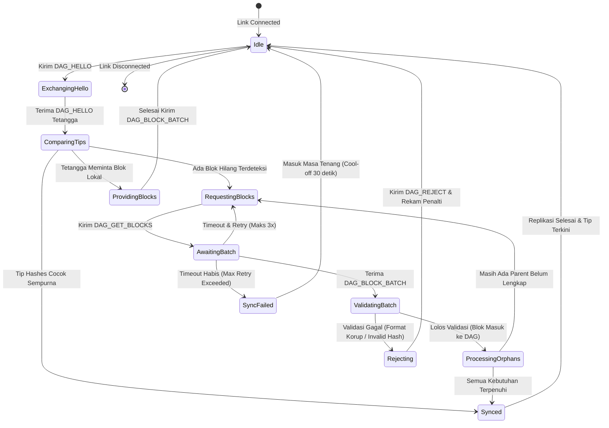
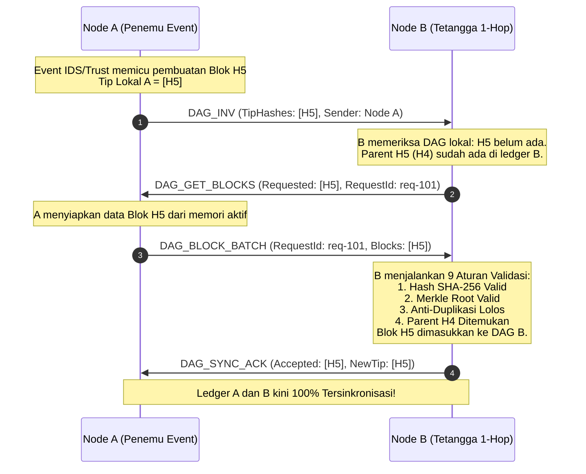
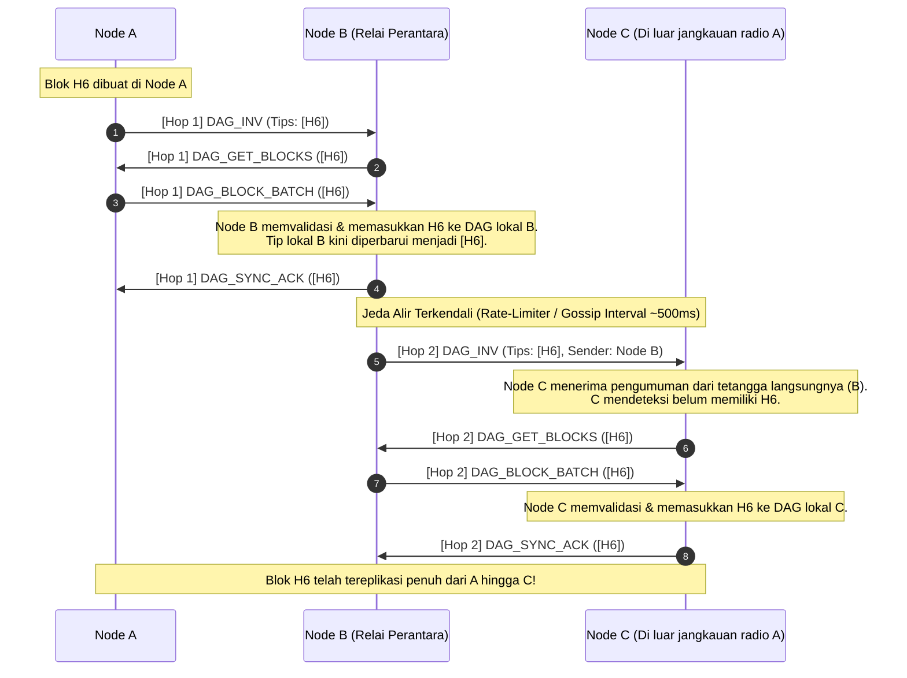
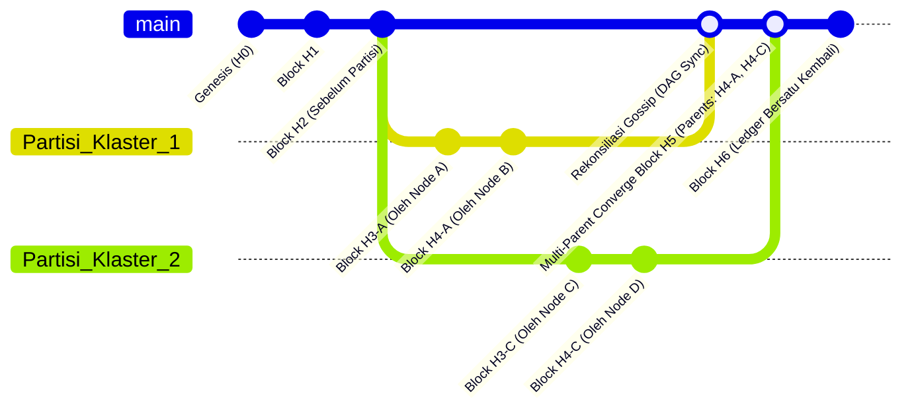
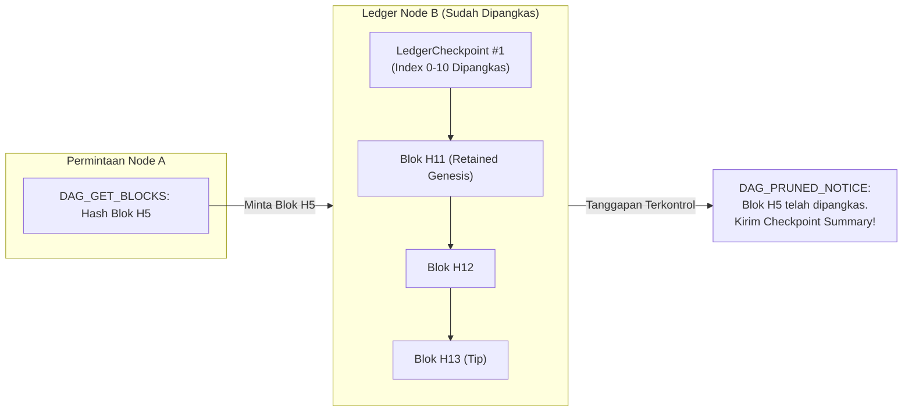
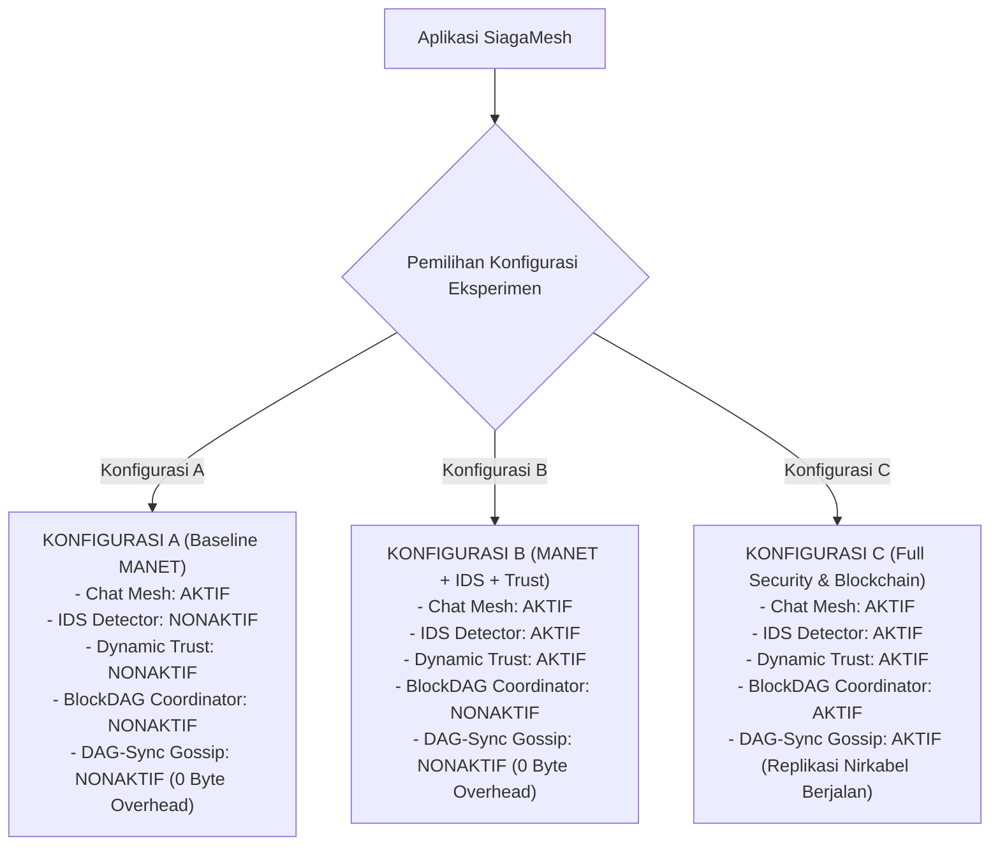

# DOKUMEN DESAIN TEKNIS PROTOKOL REPLIKASI GOSSIP BLOCKDAG SIAGAMESH
# STAGE 5E.4.1 — DESIGN-ONLY: LIGHTWEIGHT BLOCKDAG GOSSIP REPLICATION PROTOCOL

---

> **Status Dokumen**: Desain Teknis Konseptual (Design-Only)  
> **Tahap Proyek**: Stage 5E.4.1 — Perancangan Protokol Replikasi Gossip BlockDAG  
> **Tanggal Dokumen**: 19 Oktober 2026  
> **Target Proyek**: SiagaMesh — Aplikasi Komunikasi Darurat MANET Berbasis Flutter/Android  
> **Branch**: `main`  
> **Checkpoint Kode Acuan**: `1f9e594 fix(blockchain): reject non-integer schema versions`  
> **Batasan Ketat Tahap**: Tahap ini **HANYA untuk analisis arsitektural dan dokumentasi perancangan**. Tidak ada perubahan kode Dart/Kotlin pada lapisan routing atau transport, tidak ada modifikasi file pengujian, dan tidak ada klaim bahwa replikasi jaringan telah berfungsi secara operasional.

---

## 1. RINGKASAN EKSEKUTIF DAN TUJUAN PERANCANGAN

Dalam perancangan komparatif tugas akhir SiagaMesh, sistem dievaluasi pada tiga konfigurasi:
1. **Konfigurasi A (Baseline MANET)**: Komunikasi darurat multi-hop murni tanpa IDS, Dynamic Trust, maupun Blockchain.
2. **Konfigurasi B (MANET + IDS + Dynamic Trust)**: Komunikasi darurat terlindungi dengan deteksi *selective forwarding* lokal dan evaluasi reputasi dinamis.
3. **Konfigurasi C (MANET + IDS + Dynamic Trust + Lightweight Blockchain)**: Konfigurasi penuh di mana peristiwa audit keamanan (*security audit events*) dicatat ke dalam buku besar terdesentralisasi (*BlockDAG*) yang direplikasi antarnode nirkabel.

Pada Stage 5E.2 hingga Stage 5E.3.3, inti dari *Lightweight BlockDAG Ledger* dan persistensi lokalnya telah berhasil dibangun dan diuji secara deterministik di memori lokal perangkat. Namun, buku besar tersebut masih terisolasi di masing-masing node (*local ledger*).

**Tujuan Dokumen Ini**:
Merancang protokol replikasi gossip berbasis jaringan nirkabel ad-hoc (**SiagaMesh DAG-Sync Protocol**) yang memungkinkan antarnode pada Konfigurasi C untuk:
- Menemukan status ledger tetangga langsung (1-hop peer).
- Mengidentifikasi kesenjangan (*gap*) riwayat blok melalui pertukaran inventaris hash dan ujung DAG (*DAG tips*).
- Meminta dan menyinkronkan blok-blok audit yang belum dimiliki secara bertahap (*chunked/batched reconciliation*).
- Menyatukan cabang-cabang sah yang terbentuk saat partisi jaringan (*net-split*) ke dalam graf BlockDAG terpadu tanpa menghapus data audit sah (*zero event loss within active retention window*).
- Menjaga efisiensi sumber daya baterai, CPU, dan bandwidth radio agar lalu lintas replikasi audit **tidak menurunkan rasio pengiriman (PDR) dan latensi pesan obrolan darurat utama**.

---

## 2. AUDIT MENDALAM ARSITEKTUR EKSISTING DAN PEMISAHAN FAKTA

### 2.1 Pemisahan Fakta Kode Aktual, Literatur Ilmiah, dan Asumsi Perancangan

Untuk menjamin kejujuran akademis, seluruh elemen perancangan diklasifikasikan ke dalam tiga tingkatan kepastian:

| Kategori | Definisi & Batasan | Manifestasi dalam Repositori SiagaMesh |
| :--- | :--- | :--- |
| **Fakta Source Code** *(Verifiable Code)* | Komponen, fungsi, dan struktur data yang telah terkompilasi, memiliki unit test, dan diverifikasi pada commit `1f9e594`. | - `LightweightBlockdagLedger` (`lib/core/blockchain/lightweight_blockdag_ledger.dart`) dengan 9 aturan validasi blok, deduplikasi event/block, dan pemangkasan aman (`prune`).<br>- Serialisasi kanonikal deterministik SACJ-v1 dan pohon Merkle Bitcoin-Style (`lib/core/blockchain/blockchain_types.dart`).<br>- `LocalBlockdagRepository` dengan validasi ketat versi integer `schemaVersion = 1` (`lib/core/blockchain/blockdag_repository.dart`).<br>- `BlockdagSecurityCoordinator` yang mengumpulkan event dari IDS dan Trust ke batch lokal.<br>- `MeshTransport` (abstraksi 1-hop), `OneHopPayloadEnvelope`, `MessageEnvelope`, dan `ManetRoutingEngine` (controlled flooding multi-hop). |
| **Bukti Literatur** *(Empirical Literature)* | Teori, model matematis, dan temuan empiris dari publikasi ilmiah peer-reviewed. | - Teorema CAP pada permissioned ledger nirkabel (De Angelis et al., 2018): ketersediaan (*availability*) wajib diutamakan daripada konsistensi sinkron saat partisi.<br>- Model gossip inventaris hash (Nakamoto, 2008 - Bitcoin Inv/GetData architecture).<br>- Ledger terdistribusi ringan untuk node IoT/seluler berdaya rendah (Dorri et al., 2017).<br>- Rekonsiliasi asinkron berbasis DAG (Lerner, 2014; Baird, 2016). |
| **Asumsi Desain** *(Design Assumptions)* | Batasan teknis, hipotesis parameter, dan keputusan arsitektur yang diusulkan untuk direalisasikan pada tahap berikutnya. | - Ukuran paket transmisi replikasi dibatasi maksimum 16 KB per batch (di bawah batas aman envelope 32 KB).<br>- Frekuensi gossip sinkronisasi periodik diatur lambat ($T_{\text{gossip}} = 15-30$ detik) atau dipicu oleh event koneksi peer baru.<br>- Protokol gossip beroperasi murni secara lokal (1-hop pull-based) antar tetangga langsung tanpa menggunakan *blind flooding* multi-hop. |

---

### 2.2 Audit Kemampuan API yang Tersedia vs Kebutuhan Replikasi

Berdasarkan penelusuran menyeluruh terhadap file implementasi yang ada, berikut adalah matriks ketersediaan API:

| Modul / Komponen | API yang Benar-Benar Tersedia di Kode | Potensi Penggunaan Kembali untuk Replikasi | Kemampuan yang Belum Tersedia (Gap yang Harus Dirancang) |
| :--- | :--- | :--- | :--- |
| **Ledger Core** (`LightweightBlockdagLedger`) | - `tipHashes`: Mendapatkan set hash ujung DAG aktif.<br>- `getBlock(hash)`: Mengambil objek blok.<br>- `validateBlock(block)`: Validasi 9 langkah integritas.<br>- `addBlock(block)`: Memasukkan blok valid ke DAG.<br>- `getLinearReplayOrder()`: Urutan deterministik total.<br>- `isAncestor(a, d)`: Penelusuran relasi leluhur DAG.<br>- `prune()`: Pemangkasan jendela retensi (default 100 blok). | **Sangat Tinggi**: Seluruh fungsi validasi, traversal, dan penambahan blok lokal sudah lengkap dan deterministik. | - **Tidak ada Orphan Block Buffer**: Blok yang datang tanpa parent lokal langsung ditolak (`missingParent`), padahal pada jaringan nirkabel blok dapat tiba acak/terbalik.<br>- **Tidak ada fungsi DAG Diffing**: Belum ada method untuk membandingkan dua set tip dan menghasilkan daftar blok yang belum dimiliki tetangga. |
| **Persistensi** (`BlockdagRepository`) | - `loadResult()`: Memuat snapshot state lengkap.<br>- `saveState()`: Menyimpan snapshot state terkompilasi.<br>- Validasi versi ketat (menolak pecahan, nol, negatif, string, bool). | **Tinggi**: Menyimpan hasil sinkronisasi blok ke memori permanen perangkat. | - Belum mendukung penyimpanan parsial inkremental (saat ini menyimpan keseluruhan snapshot state). |
| **Koordinator** (`BlockdagSecurityCoordinator`) | - Menerima stream IDS dan Trust.<br>- Batching timer dan flush otomatis ($K=4, T=30\text{s}$).<br>- Pencatatan metrik performa lokal. | **Sedang**: Dapat menjadi *mediator* antara aplikasi lokal dengan engine gossip. | - **Belum terhubung ke jaringan**: Koordinator saat ini murni lokal, belum memiliki antarmuka pengiriman/penerimaan paket nirkabel. |
| **Transport Layer** (`MeshTransport`) | - `sendBytes(endpointId, bytes)`: Pengiriman byte langsung 1-hop.<br>- `connectionEventsStream`: Notifikasi connect/disconnect.<br>- `payloadStream`: Stream data masuk mentah.<br>- `discoveredPeersStream`: Daftar tetangga fisik. | **Sangat Tinggi**: Menjadi pipa pengiriman pesan biner replikasi antar-smartphone. | - **Sifat Dasar 1-Hop**: Transport (Nearby Connections) hanya menghubungkan tetangga radio langsung. Tidak memiliki routing otomatis hardware. |
| **Routing Layer** (`ManetRoutingEngine`) | - `neighborTable`: Pemetaan `endpointId` (transport) $\leftrightarrow$ `nodeId` (aplikasi).<br>- `dedupCache`: LRU filter 500 ID pesan.<br>- Handshake identitas (`PEER_HANDSHAKE`).<br>- Controlled flooding untuk pesan teks obrolan (`CHAT_MESSAGE`). | **Tinggi**: Mengetahui kapan tetangga baru terhubung dan siapa identitas aplikasinya. | - **Tidak ada tipe envelope untuk Blockchain**: `MessageEnvelope.type` saat ini hanya mengenal `CHAT_MESSAGE`, `PEER_HANDSHAKE`, `HOP_ACK`, `E2E_ACK`.<br>- Belum ada pemisahan antrean prioritas (lalu lintas chat vs lalu lintas audit). |

---

### 2.3 Penegasan Arsitektur Transport: 1-Hop vs Multi-Hop Aplikasi

> [!IMPORTANT]
> **Pernyataan Arsitektur Fisik**:  
> Google Nearby Connections (`Strategy.P2P_CLUSTER`) menyediakan tautan komunikasi langsung **satu-hop (1-hop device-to-device)** melalui kombinasi Bluetooth Low Energy (advertisement/discovery) dan Wi-Fi Direct / BLE L2CAP (data payload transfer).  
> **Tidak ada lapisan routing MANET otomatis di tingkat sistem operasi Android atau driver nirkabel**.  
> Seluruh kapabilitas multi-hop (misal penerusan $A \rightarrow B \rightarrow C$) adalah **tanggung jawab murni lapisan aplikasi SiagaMesh** (`ManetRoutingEngine`), yang mengekstrak `routeTrace`, mengevaluasi `ttl`, dan meneruskan pesan secara sadar di memori aplikasi Flutter.

---

## 3. RANCANGAN PROTOKOL GOSSIP REPLIKASI BLOCKDAG (SIAGAMESH DAG-SYNC)

### 3.1 Prinsip Perancangan: Mengapa "Pull-Based Inventory Gossip", Bukan "Push Flooding"?

Jika node langsung menyiarkan (*blind flooding*) setiap blok baru ke seluruh jaringan MANET:
1. **Radio Collisions & Congestion**: Blok berukuran 500–2000 byte akan membanjiri antrean radio, menyebabkan tabrakan paket (*packet collisions*), dan menggagalkan pesan darurat SOS korban.
2. **Duplikasi Transmisi Boros Bandwidth**: Node yang sudah memiliki blok tersebut akan tetap menerima payload byte penuh berulang kali.
3. **Amplifikasi Partisi**: Node yang baru saja bergabung kembali setelah terputus (*net-split*) akan dibombardir oleh puluhan blok sekaligus tanpa kendali laju alir (*flow control*).

Oleh karena itu, SiagaMesh mengadopsi prinsip **Pull-Based Inventory Reconciliation (terinspirasi dari arsitektur Bitcoin Inv/GetData, namun disesuaikan untuk struktur graf BlockDAG terdistribusi tanpa Proof-of-Work)**:
- Node hanya mengumumkan **ringkasan status (Tips & Ledger Index)** melalui pesan kontrol kecil (< 200 byte).
- Node penerima membandingkan inventaris tersebut dengan DAG lokalnya.
- Node penerima **secara selektif meminta hanya blok yang belum dimilikinya** secara bertahap (*batched paging*).

```mermaid
flowchart TD
    subgraph PushModel ["Pendekatan Push Flooding (DITOLAK)"]
        P1["Node A Buat Blok (1.5 KB)"] -->|Kirim Blok Penuh Langsung| P2["Node B (Menerima)"]
        P1 -->|Kirim Blok Penuh Langsung| P3["Node C (Menerima)"]
        P2 -->|Banjir Ulang Blok Penuh| P3
        Note1["Beban Radio Sangat Boros & Rawan Tabrakan"]
    end

    subgraph PullModel ["Pendekatan SiagaMesh DAG-Sync (DIADOPASI)"]
        A1["Node A"] -->|1. DAG_INV: Hash Ujung DAG (128 byte)| B1["Node B"]
        B1 -->|2. Periksa Ledger Lokal: Ada Blok Hilang?| B2{"Blok Ada?"}
        B2 -- Sudah Lengkap --> B3["Selesai (0 Byte Payload Ditransmisikan)"]
        B2 -- Ada yang Hilang --> B4["3. DAG_GET_BLOCKS: Minta Hash Spesifik"]
        B4 --> A1
        A1 -->|4. DAG_BLOCK_BATCH: Kirim Blok Terpilih| B1
    end
```

---

### 3.2 Pemisahan Tegas Dua Saluran Lalu Lintas

Untuk menjamin evaluasi tugas akhir yang valid dan adil, sistem memisahkan dua kanal data:
1. **Kanal Lalu Lintas Pesan Darurat (Chat Data Plane)**:
   - Menggunakan `MessageEnvelope` dengan prioritas tertinggi.
   - Perutean multi-hop berbasis *controlled flooding* + *store-and-forward*.
   - Wajib berjalan tanpa hambatan pada Konfigurasi A, B, dan C.
2. **Kanal Replikasi Audit Keamanan (Ledger Sync Control Plane)**:
   - Beroperasi **hanya 1-hop bertahap antar-tetangga langsung**. Replikasi ke ujung jaringan terjadi secara alami (*epidemic gossip*) saat blok berpindah dari tetangga ke tetangga.
   - Menggunakan kuota bandwidth terbatas dan laju alir terkontrol (*rate-limited*).
   - **Hanya aktif pada Konfigurasi C**.

---

### 3.3 Sembilan Alur Utama Protokol Replikasi Gossip

#### Alur 1: Pengenalan Peer dan Pertukaran Ringkasan Ledger (Handshake & Summary)
- Saat transport 1-hop mendeteksi tetangga baru dan koneksi terjalin (`PeerConnectionStatus.connected`), handshake aplikasi standar (`PEER_HANDSHAKE`) dieksekusi oleh routing engine.
- Jika Konfigurasi C aktif, koordinator replikasi mengirimkan pesan kontrol awal: `DAG_HELLO`.
- **Isi Pesan**: Identitas node, `currentSchemaVersion`, `activeBlocksCount`, `maxIndex`, serta daftar `tipHashes` saat ini.
- **Tujuan**: Memungkinkan tetangga mengetahui secara cepat apakah ledger mereka sudah selaras atau terdapat perbedaan riwayat.

#### Alur 2: Pertukaran Tip DAG dan Inventaris Hash (`DAG_INV`)
- Tip DAG merepresentasikan batas terluar (*leaf nodes*) dari graf audit lokal.
- Jika Tip Hash Node A sama persis dengan Tip Hash Node B, maka kedua node memiliki kepastian tinggi bahwa graf mereka berada pada kondisi identik, sehingga proses sinkronisasi selesai seketika tanpa transfer data lebih lanjut.
- Jika Tip Hash berbeda, salah satu atau kedua node mengirimkan `DAG_INV` yang memuat ringkasan rantai lokalnya.

#### Alur 3: Identifikasi Blok yang Belum Dimiliki Peer (DAG Diffing & Traversal)
- Penerima pesan `DAG_INV` memeriksa apakah tip tetangga sudah ada di ledger lokalnya (`ledger.getBlock(tipHash) != null`).
- Kasus A (*Peer Tertinggal*): Jika tip tetangga merupakan *ancestor* dari tip lokal (`ledger.isAncestor(peerTip, localTip)`), node lokal menyadari tetangga tertinggal.
- Kasus B (*Node Lokal Tertinggal*): Jika tip tetangga belum dikenal, node lokal menyiapkan daftar permintaan blok.
- Kasus C (*Percabangan Partisi / Net-Split*): Kedua node memiliki tip yang saling tidak mengenal. Kedua rantai adalah sah dan perlu digabungkan.

#### Alur 4: Permintaan dan Pengiriman Blok Bertahap (Chunked Paging)
- Node yang membutuhkan blok mengirimkan pesan `DAG_GET_BLOCKS` dengan daftar hash spesifik yang diminta.
- Permintaan dibatasi maksimum $M = 4$ blok per batch permintaan untuk mencegah saturasi buffer radio.
- Node penjawab merespons dengan pesan `DAG_BLOCK_BATCH` yang memuat blok-blok yang diminta.

#### Alur 5: Validasi Blok Masuk Sebelum Diterima
Setiap blok yang diterima di dalam `DAG_BLOCK_BATCH` **wajib melalui 9 tahapan validasi ketat** yang telah terimplementasi di `LightweightBlockdagLedger.validateBlock(block)`:
1. `version == 1`
2. Format `blockHash` dan `merkleRoot` adalah 64 karakter hex huruf kecil.
3. Struktur indeks valid ($index \ge 0$, non-genesis wajib memiliki minimal satu parent).
4. Anti-duplikasi blok: `_processedBlockHashes.contains(blockHash) == false`.
5. Ketersediaan parent: Seluruh parent block wajib sudah ada di jendela aktif atau checkpoint.
6. Asiklisitas: $index_{\text{block}} > index_{\text{parent}}$ untuk seluruh parent aktif.
7. Rekomputasi pohon Merkle cocok dengan `merkleRoot`.
8. Rekomputasi serialisasi kanonikal SACJ-v1 cocok dengan `blockHash`.
9. Anti-duplikasi event: Seluruh `eventId` unik secara internal dan belum pernah tercatat di `_processedEventIds`.
10. Validasi batas timestamp terhadap parent dan masa depan.

#### Alur 6: Penanganan Blok Duplikat, Kedatangan Tidak Berurutan, dan Multi-Parent DAG
- **Blok Duplikat**: Jika hash blok sudah ada di `_processedBlockHashes`, blok langsung dibuang tanpa pemrosesan ulang (*silent drop*), mencegah serangan *replay loop*.
- **Kedatangan Tidak Berurutan (Out-of-Order / Orphan Handling)**:
  - Jika blok valid secara kriptografis namun parent-nya belum tiba (`LedgerValidationStatus.missingParent`), blok **tidak dibuang ke tempat sampah**, melainkan ditampung di antrean sementara: **Orphan Block Pool**.
  - Orphan Pool dibatasi maksimal 20 blok dan memiliki batas kadaluwarsa (TTL 60 detik) untuk mencegah eksploitasi kehabisan memori (*memory exhaustion DoS*).
  - Segera setelah parent-nya berhasil diunduh dan divalidasi, blok anak di Orphan Pool dipicu secara otomatis untuk divalidasi ulang dan dimasukkan ke DAG.
- **Konvergensi Multi-Parent**:
  - Ketika dua cabang dari partisi berbeda disatukan, blok lokal berikutnya yang dibuat oleh node akan secara otomatis mencantumkan **seluruh tip aktif yang belum memiliki anak sebagai parent-nya** (`parentBlockHashes = [_tipHashes]`).
  - Hal ini secara matematis mengonvergensikan graf DAG kembali menjadi satu ujung bersama tanpa kehilangan satu pun event audit (*zero event loss*).

#### Alur 7: ACK, Timeout, Retry, dan Penanganan Peer Terputus
- Setelah batch blok berhasil diproses dan disimpan ke database lokal, node penerima mengirimkan `DAG_SYNC_ACK`.
- Jika pengirim tidak menerima `DAG_SYNC_ACK` atau respons dalam jendela timeout ($T_{\text{timeout}} = 5$ detik), retry dilakukan maksimal 3 kali menggunakan mekanisme *exponential backoff with jitter* ($T_{\text{wait}} = 2^r \times 1000\text{ms} \pm \text{jitter}$).
- Jika peer terputus fisik di tengah proses sinkronisasi (`PeerConnectionStatus.disconnected`), proses dihentikan secara aman tanpa merusak konsistensi ledger lokal (sifat *atomic per block*). State sinkronisasi parsial yang sudah divalidasi tetap sah tersimpan di disk.

#### Alur 8: Rekonsiliasi Kembali Pasca-Partisi Jaringan (Net-Split Recovery)
- Skenario bencana: Kelompok Node {A, B} terpisah dari Kelompok {C, D} selama 30 menit. Masing-masing kelompok terus mencatat insiden keamanan lokal ke DAG mereka masing-masing.
- Saat Node B dan Node C bergerak mendekat dan tautan radio kembali terhubung:
  1. Pertukaran `DAG_HELLO` mendeteksi perbedaan himpunan tip.
  2. B mengunduh blok-blok baru milik C yang belum dimiliki B.
  3. C mengunduh blok-blok baru milik B yang belum dimiliki C.
  4. Graf BlockDAG di kedua belah pihak kini memuat kedua cabang riwayat.
  5. Saat Node B atau C membuat blok audit berikutnya, blok baru tersebut akan menggabungkan tip dari cabang B dan tip dari cabang C sebagai multi-parent.
  6. Cabang resmi menyatu kembali secara deterministik.

#### Alur 9: Pembatasan Sumber Daya (Batch Size, Antrean, Rate Limiting, Backpressure)
- **Ukuran Payload Maksimum**: Satu paket pesan replikasi tidak boleh melebihi 16 KB.
- **Batas Batch Blok**: Maksimal 4 blok per pengiriman batch.
- **Batas Laju Permintaan (Rate Limiting)**: Setiap peer dibatasi maksimal mengirimkan 2 permintaan sinkronisasi per interval 10 detik.
- **Backpressure**: Jika penggunaan CPU atau antrean pemrosesan pesan lokal melebihi kapasitas aman, node dapat menunda respons replikasi atau mengirimkan kode penolakan sementara `DAG_BUSY`.

---

## 4. SPESIFIKASI FORMAT PESAN PROTOKOL REPLIKASI (MESSAGE SCHEMAS)

Seluruh pesan replikasi dibungkus dalam payload JSON terstandarisasi yang disalurkan melalui `MeshTransport.sendBytes` atau diperluas melalui `MessageEnvelope`.

### 4.1 Schema 1: `DAG_HELLO` (Handshake & Ringkasan Ledger)
- **Tujuan**: Mengumumkan status awal ledger lokal ke tetangga 1-hop saat tautan baru terbentuk.
- **Format JSON Minimal**:
```json
{
  "protocol": "SIAGAMESH_DAG_SYNC",
  "version": 1,
  "type": "DAG_HELLO",
  "senderNodeId": "NODE-A",
  "senderTimestamp": 1792381200000,
  "schemaVersion": 1,
  "activeBlocksCount": 12,
  "maxIndex": 8,
  "tipHashes": [
    "7f83b1657ff1fc53b92dc18148a1d65dfc2d4b1fa3d677284addd200126d9069"
  ],
  "genesisHash": "e3b0c44298fc1c149afbf4c8996fb92427ae41e4649b934ca495991b7852b855"
}
```
- **Aturan Validasi Penerima**:
  - `protocol == "SIAGAMESH_DAG_SYNC"` dan `version == 1`.
  - `schemaVersion` harus bilangan bulat positif yang didukung (`supportedSchemaVersions.contains(schemaVersion)`).
  - `genesisHash` wajib cocok dengan genesis lokal. Jika genesis berbeda, kedua node berasal dari jaringan eksperimen yang berbeda $\rightarrow$ tolak koneksi dengan status `INCOMPATIBLE_NETWORK`.
- **Tindakan Respons**: Jika `tipHashes` identik $\rightarrow$ abaikan (sinkron). Jika berbeda $\rightarrow$ kirim `DAG_INV` atau minta blok via `DAG_GET_BLOCKS`.

---

### 4.2 Schema 2: `DAG_INV` (Inventaris Hash Ujung DAG)
- **Tujuan**: Memberitahukan daftar hash blok terbaru atau ujung rantai yang tersedia pada node pengirim.
- **Format JSON Minimal**:
```json
{
  "protocol": "SIAGAMESH_DAG_SYNC",
  "version": 1,
  "type": "DAG_INV",
  "senderNodeId": "NODE-A",
  "senderTimestamp": 1792381205000,
  "tipHashes": [
    "a1b2c3d4e5f60718293a4b5c6d7e8f90123456789abcdef0123456789abcdef0",
    "b2c3d4e5f60718293a4b5c6d7e8f90123456789abcdef0123456789abcdef01"
  ],
  "recentBlockHashes": [
    "a1b2c3d4e5f60718293a4b5c6d7e8f90123456789abcdef0123456789abcdef0"
  ]
}
```
- **Aturan Validasi Penerima**:
  - Seluruh elemen hash dalam array wajib berupa string 64 karakter hex valid.
  - Jumlah hash dalam satu inventaris dibatasi maksimal 32 hash.

---

### 4.3 Schema 3: `DAG_GET_BLOCKS` (Permintaan Pengiriman Blok)
- **Tujuan**: Meminta tetangga mengirimkan blok-blok tertentu berdasarkan hash yang belum dimiliki peminta.
- **Format JSON Minimal**:
```json
{
  "protocol": "SIAGAMESH_DAG_SYNC",
  "version": 1,
  "type": "DAG_GET_BLOCKS",
  "senderNodeId": "NODE-B",
  "requestId": "req-b-1792381206",
  "requestedBlockHashes": [
    "a1b2c3d4e5f60718293a4b5c6d7e8f90123456789abcdef0123456789abcdef0"
  ]
}
```
- **Aturan Validasi Penerima**:
  - `requestedBlockHashes` tidak boleh kosong dan dibatasi maksimal 4 hash per request.
  - Jika hash yang diminta tidak ditemukan di memori lokal penjawab (misal sudah terpangkas di luar jendela retensi), kembalikan pesan informasi `DAG_PRUNED_NOTICE`.

---

### 4.4 Schema 4: `DAG_BLOCK_BATCH` (Pengiriman Kumpulan Blok)
- **Tujuan**: Menyalurkan blok-blok audit aktual beserta event-event keamanannya kepada peminta.
- **Format JSON Minimal**:
```json
{
  "protocol": "SIAGAMESH_DAG_SYNC",
  "version": 1,
  "type": "DAG_BLOCK_BATCH",
  "senderNodeId": "NODE-A",
  "requestId": "req-b-1792381206",
  "batchIndex": 1,
  "totalBatches": 1,
  "blocks": [
    {
      "version": 1,
      "index": 5,
      "blockHash": "a1b2c3d4e5f60718293a4b5c6d7e8f90123456789abcdef0123456789abcdef0",
      "parentBlockHashes": [
        "e3b0c44298fc1c149afbf4c8996fb92427ae41e4649b934ca495991b7852b855"
      ],
      "creatorNodeId": "NODE-A",
      "timestampMs": 1792381200000,
      "timestampIso": "2026-10-19T12:00:00.000Z",
      "monotonicMicros": 4500000,
      "eventsCount": 1,
      "merkleRoot": "11223344556677889900aabbccddeeff00112233445566778899aabbccddeeff",
      "events": [
        {
          "eventId": "ids-evt-201",
          "eventType": "idsDetection",
          "observerNodeId": "NODE-A",
          "targetNodeId": "NODE-X",
          "timestampMs": 1792381190000,
          "timestampIso": "2026-10-19T11:59:50.000Z",
          "monotonicMicros": 4450000,
          "metadata": {
            "status": "suspected",
            "observedDropRate": 0.55,
            "reason": "Drop rate 0.55 melebihi ambang batas"
          }
        }
      ],
      "validationProof": {
        "creatorNodeName": "Relawan Pos A"
      }
    }
  ]
}
```
- **Aturan Validasi Penerima**:
  - Ukuran total payload tidak melebihi 16 KB.
  - Setiap objek dalam `blocks` di-parse menggunakan `SecurityBlock.fromMap` dan diuji secara ketat melalui `validateBlock`.

---

### 4.5 Schema 5: `DAG_SYNC_ACK` (Konfirmasi Penerimaan Blok)
- **Tujuan**: Mengonfirmasi bahwa batch blok tertentu telah diterima, divalidasi, dan dimasukkan ke ledger lokal peminta.
- **Format JSON Minimal**:
```json
{
  "protocol": "SIAGAMESH_DAG_SYNC",
  "version": 1,
  "type": "DAG_SYNC_ACK",
  "senderNodeId": "NODE-B",
  "requestId": "req-b-1792381206",
  "acceptedBlockHashes": [
    "a1b2c3d4e5f60718293a4b5c6d7e8f90123456789abcdef0123456789abcdef0"
  ],
  "newTipHashes": [
    "a1b2c3d4e5f60718293a4b5c6d7e8f90123456789abcdef0123456789abcdef0"
  ]
}
```

---

### 4.6 Schema 6: `DAG_REJECT` (Notifikasi Penolakan Blok / Kesalahan Protokol)
- **Tujuan**: Menginformasikan pengirim bahwa blok atau permintaannya ditolak beserta alasan spesifik.
- **Format JSON Minimal**:
```json
{
  "protocol": "SIAGAMESH_DAG_SYNC",
  "version": 1,
  "type": "DAG_REJECT",
  "senderNodeId": "NODE-B",
  "rejectedHash": "badblockhash1234567890abcdef...",
  "errorCode": "INVALID_MERKLE_ROOT",
  "errorMessage": "Rekonstruksi pohon Merkle tidak cocok dengan nilai root di header"
}
```

---

## 5. DIAGRAM ALUR, STATE MACHINE, DAN SKENARIO TOPOLOGI

### 5.1 State Machine Siklus Sinkronisasi Peer (Peer Sync State Machine)

Setiap koneksi tetangga aktif memiliki mesin status lokal (*per-peer sync state machine*) untuk mengatur alur replikasi secara tertib:



---

### 5.2 Sequence Diagram: Skenario Standar Sinkronisasi Dua Node (A $\leftrightarrow$ B)

Skenario saat Node A menghasilkan blok audit baru ($H_5$) dan mereplikasikannya ke tetangga langsung Node B:



---

### 5.3 Sequence Diagram: Skenario Tiga Node Multi-Hop (A $\rightarrow$ B $\rightarrow$ C)

Skenario penyebaran blok dari Node A ke Node C yang berada di luar jangkauan radio langsung A (melewati Node B sebagai relai perantara):

> [!IMPORTANT]
> **Penegasan Mekanisme**: Node A **tidak** membanjiri paket ke Node C secara langsung. Replikasi terjadi secara *hop-by-hop gossip*: Node A mereplikasi ke Node B, lalu setelah Node B memvalidasi blok tersebut ke dalam ledger lokalnya, Node B secara independen mengumumkan ketersediaan blok tersebut kepada Node C pada sesi gossip berikutnya.



---

### 5.4 Skenario Pemulihan Partisi Jaringan (Net-Split & Partition Merge)

Diagram berikut mengilustrasikan bagaimana dua cabang audit independen yang terbentuk saat partisi disatukan tanpa konflik:



- **Rasional**: Tidak ada cabang yang "kalah" atau dibuang sebagai *orphan*. Kedua cabang riwayat audit dipertahankan. Node yang membuat blok baru pasca-rekonsiliasi cukup mencantumkan `parentBlockHashes = [H4-A, H4-C]`, mengonvergensikan kembali graf menjadi satu kesatuan.

---

## 6. INTEGRITAS KRIPTOGRAFIS, MODEL ANCAMAN, DAN BATAS KEAMANAN

### 6.1 Integritas Kriptografis dan Ketelitian Deterministik

Protokol replikasi mengandalkan jaminan matematika dan kanonisasi yang telah terpasang pada kode:
1. **Serialisasi Kanonikal SACJ-v1**: Header blok di-encode secara deterministik sebelum di-hash dengan SHA-256. Setiap modifikasi satu bit pun akan mengubah `blockHash` secara radikal dan langsung digugurkan pada aturan validasi ke-7 (`invalidHeaderHash`).
2. **Pohon Merkle Deterministic**: Integritas kumpulan event audit dijamin oleh Merkle Root bergaya Bitcoin. Manipulasi pada metadata event akan menghasilkan Merkle root yang tidak cocok (`invalidMerkleRoot`).
3. **Pencegahan Siklus (DAG Acyclicity)**: Ditegakkan melalui relasi indeks non-negatif yang menaik secara tegas: $index_{\text{child}} > index_{\text{parent}}$. Sebuah blok tidak dapat menjadi leluhur bagi dirinya sendiri, menggagalkan serangan siklus graf tak terhingga (*infinite loop DAG attack*).

---

### 6.2 Model Ancaman Replikasi dan Strategi Mitigasi

| Vektor Serangan | Karakteristik Serangan | Dampak Tanpa Mitigasi | Strategi Mitigasi SiagaMesh DAG-Sync |
| :--- | :--- | :--- | :--- |
| **1. Block Flood / DoS Spamming** | Node jahat membanjiri tetangga dengan ratusan blok palsu atau permintaan `DAG_GET_BLOCKS` fiktif. | Buffer memori RAM smartphone habis, baterai terkuras, radio macet (*resource exhaustion*). | **Rate Limiting & Bounded Ingress Queue**: Maksimal 2 request per 10 detik. Jika node mengirim blok invalid, pasang status *penalti sementara* (abaikan pesan sync dari endpoint tersebut selama 60 detik). |
| **2. Replay of Old Blocks** | Node penyerang menyiarkan ulang blok audit lama yang sah untuk memicu kebingungan tip DAG. | Komputasi verifikasi berulang-ulang pada node penerima. | **Anti-Replay Cache (`_processedBlockHashes`)**: Pengecekan instan $O(1)$ pada filter set hash. Jika sudah pernah diproses, paket langsung di-*drop* tanpa verifikasi ulang Merkle tree. |
| **3. Event Injection Attack (Double-Spending of Events)** | Penyerang mengambil event dari blok node lain dan memasukkannya ke dalam blok buatannya sendiri. | Reputasi node korban dapat dipotong ganda atau terjadi inkonsistensi event audit. | **Anti-Duplikasi Event Global (`_processedEventIds`)**: Validasi aturan ke-8 mewajibkan seluruh `eventId` di dalam blok belum pernah tercatat di seluruh riwayat ledger aktif maupun checkpoint. |
| **4. Timestamp Manipulation (Time-Warp Attack)** | Penyerang menetapkan timestamp tahun 2050 untuk memanipulasi pengurutan linear replay. | Pengurutan total (*linear replay order*) dapat terdistorsi ke masa depan. | **Batas Toleransi Drift Waktu (`maxFutureDrift`)**: Blok dengan timestamp melompat melebihi batas toleransi ke depan (default: $\pm 5$ menit dari jam lokal penerima) otomatis ditolak (`timestampOutOfBounds`). |
| **5. Orphan Flooding Attack** | Penyerang mengirimkan ribuan blok valid yang sengaja merujuk ke parent fiktif yang tidak pernah ada. | Penumpukan memori tak terbatas pada antrean *orphan pool*. | **Bounded Orphan Pool with TTL**: Maksimal kapasitas 20 blok orphan. Jika penuh, orphan terlama dibuang (FIFO). Setiap orphan memiliki TTL kadaluwarsa 60 detik. |

---

### 6.3 Penegasan Batas Keamanan: Apa yang BISA dan TIDAK BISA Dijamin?

> [!CAUTION]
> **Pernyataan Batas Keamanan Skripsi**:  
> Kegagalan membedakan antara *integritas data kriptografis* dan *kebenaran faktual* adalah cacat metodologis umum dalam penelitian blockchain. Batas-batas berikut ditegaskan secara transparan:

1. **Yang DAPAT Dijamin oleh Desain Ini**:
   - **Integritas Imutabel (Tamper-Evidence)**: Tidak ada satu node pun yang dapat mengubah isi blok masa lalu tanpa merusak seluruh rantai hash dan ditolak oleh tetangga.
   - **Kausalitas Parsial Terdistribusi**: Hubungan "kejadian A terjadi sebelum kejadian B" dapat dibuktikan jika blok B memiliki relasi leluhur (*ancestor*) ke blok A pada graf DAG.
   - **Idempotensi & Ketiadaan Duplikasi**: Tidak ada event audit yang diproses ganda di dalam ledger aktif.
   - **Ketersediaan saat Bencana (High Availability)**: Setiap node dapat terus mencatat insiden audit lokal saat terisolasi dan menyatukannya kembali saat terhubung.

2. **Yang TIDAK DAPAT Dijamin oleh Desain Ini**:
   - **Kebenaran Faktual (Factual Truth)**: Jika Node Jahat B mengirimkan laporan IDS palsu bahwa "Node A menjatuhkan 100 paket", BlockDAG akan mencatat klaim tersebut secara permanen dan sah secara format. **Blockchain tidak dapat mengetahui apakah Node A benar-benar menjatuhkan paket di dunia fisik**. Verifikasi faktual tetap berada pada Dynamic Trust Manager lokal yang membandingkan klaim dengan observasi langsung (*direct observation*).
   - **Keaslian Identitas Kriptografis (Source Authenticity)**: Karena sistem saat ini belum mengimplementasikan Public Key Infrastructure (PKI) dengan tanda tangan asimetris Ed25519/ECDSA, identitas `creatorNodeId` masih berbasis klaim diri (*self-claimed*). Sebuah node dapat memalsukan nama pembuat blok jika tidak ada lapisan tanda tangan kriptografis.
   - **Konsensus Global Waktu Nyata**: BlockDAG mengorbankan konsistensi sekuensial tunggal demi mempertahankan ketersediaan (*availability*) saat net-split (mengacu Teorema CAP).

---

### 6.4 Mengapa Algoritma Konsensus Baru TIDAK Diterapkan pada Tahap Ini?

Pada analisis Stage 5E.1, telah dievaluasi tiga alternatif konsensus:
- **Proof-of-Work (PoW)**: Ditolak karena menguras baterai smartphone Android dan lambat.
- **Proof-of-Trust / PBFT-Lite**: Ditolak karena rentan *circular dependency* (kepercayaan validator bergantung pada data yang sedang divalidasi) dan mengalami **liveness failure total (deadlock)** saat partisi jaringan MANET membagi kuorum ($< 67\%$).
- **Epidemic DAG-Sync with Deterministic Replay Order**: **Dipilih sebagai arsitektur resmi**.

**Keputusan Tahap 5E.4.1**:
Tidak menambahkan atau mengklaim algoritma konsensus voting baru. Model konvergensi BlockDAG dengan pengurutan linier deterministik:
$$\text{Urutan Replay} = (\text{blockIndex ASC}, \text{timestampMs ASC}, \text{creatorNodeId ASC}, \text{blockHash ASC})$$
sudah cukup untuk menjamin bahwa seluruh node yang memiliki himpunan blok yang sama akan merekonstruksi state reputasi yang identik secara deterministik.

---

## 7. PARTISI JARINGAN DAN KETERBATASAN PERANGKAT MOBILE

### 7.1 Karakteristik Partisi pada MANET Darurat

Pada skenario gempa bumi, banjir, atau operasi SAR di daerah terpencil:
- Topologi nirkabel berubah cepat (*high churn rate*).
- Node sering berada dalam kondisi terputus total (*intermittent connectivity*).
- Dua klaster node dapat terpisah selama durasi panjang (puluhan menit hingga beberapa jam).

### 7.2 Hubungan Jendela Retensi (Pruning) dengan Blok yang Dipangkas

Untuk mencegah pembengkakan memori flash pada smartphone Android pengguna:
- Engine ledger membatasi jendela blok aktif maksimal $W = 100$ blok (`maxRetentionBlocks = 100`).
- Jika jumlah blok melebihi $W$, blok-blok terlama dipangkas ke dalam titik jangkar `LedgerCheckpoint`.

**Tantangan Sinkronisasi Pasca-Pruning**:
Bagaimana jika Node A yang baru saja terhubung kembali meminta blok dengan index 2, sementara Node B sudah memangkas blok tersebut ke dalam checkpoint?



**Solusi Desain SiagaMesh**:
1. Node penjawab yang sudah memangkas blok yang diminta mengembalikan pesan `DAG_PRUNED_NOTICE` yang menyertakan metadata `LedgerCheckpoint` terakhir.
2. Node peminta mengevaluasi apakah ia dapat menerima `retainedGenesisHash` sebagai titik tolak jangkar baru.
3. Jika peminta menyetujui, peminta menyelaraskan riwayatnya mulai dari titik jangkar checkpoint tersebut.

> [!WARNING]
> **Batasan Teoretis**: Node yang terisolasi terlalu lama hingga melebihi jendela retensi (misal tertinggal lebih dari 100 blok) tidak dapat memverifikasi rantai hash secara utuh ke blok genesis awal. Verifikasi dilakukan terhadap integritas *checkpoint anchor* yang disepakati.

---

### 7.3 Backpressure dan Perlindungan Sumber Daya Android

Aplikasi darurat tidak boleh mengalami *Application Not Responding* (ANR) atau dimatikan oleh sistem operasi Android karena kehabisan memori (*Out Of Memory / OOM*):
1. **Penyimpanan Flash Bounded**: Seluruh state aktif ledger dibatasi maksimal ~500 KB per perangkat.
2. **Pembatasan I/O SharedPreferences**: Penyimpanan lokal persisten hanya dipicu saat blok baru ditambahkan (`addBlock`), bukan pada setiap pertukaran pesan kontrol gossip.
3. **Penyaringan Ukuran Paket Transport**: Setiap payload nirkabel yang masuk melalui `MeshTransport` langsung ditolak di gerbang awal jika ukurannya melebihi 32 KB, melindungi parser JSON dari eksploitasi string besar.

---

## 8. BATAS PRIVASI DAN ISOLASI KONFIGURASI PENELITIAN

### 8.1 Prinsip Minimisasi Data & Privasi Mutlak Korban

Sesuai prinsip etika rekayasa perangkat lunak dan protokol kebencanaan:
- **DILARANG KERAS** mereplikasi atau memasukkan isi pesan percakapan obrolan korban/relawan ke dalam blok ledger.
- **DILARANG KERAS** mereplikasi koordinat presisi GPS, nomor kontak darurat, atau catatan medis korban ke dalam ledger.
- **Yang Boleh Direplikasi**: Hanya metadata audit teknis:
  - `eventId` (misal `ids-evt-101`)
  - `observerNodeId` & `targetNodeId` (ID teknis internal perangkat)
  - `observedDropRate` & skor perubahan trust (angka desimal reputasi)
  - Alasan teknis perutean (misal `DROP_RATE_EXCEEDED_THRESHOLD`)
  - Hash SHA-256 dan Merkle Root.

---

### 8.2 Isolasi Ketat Tiga Konfigurasi Eksperimen

Agar hasil pengukuran komparatif pada Bab IV tugas akhir valid dan tidak bias:



- **Jaminan Isolasi**: Komponen protokol replikasi gossip **wajib dikapsulasi di balik flag modular** (misal `enableBlockdagReplication = false` secara default).
- Pada Konfigurasi A dan Konfigurasi B, modul gossip tidak boleh mengalokasikan timer, tidak boleh mengirimkan satu byte pun paket kontrol (`DAG_HELLO` / `DAG_INV`), dan tidak boleh memotong antrean pesan chat.

---

## 9. RENCANA EVALUASI DAN MATRIKS PENGUJIAN

Rencana pengujian dibagi menjadi dua tahapan metodologis:
1. **Pengujian Unit & Simulasi Deterministik (Software-in-the-Loop)**: Dieksekusi di workstation/CI menggunakan *Fake Transport* dan multi-node mock.
2. **Evaluasi Radio Fisik Lapangan (Physical Hardware-in-the-Loop)**: Pengujian dengan smartphone Android fisik.

> [!IMPORTANT]
> **Penegasan Status Pengujian**:  
> Seluruh evaluasi multi-hop radio fisik nirkabel pada smartphone sungguhan berstatus **`PENDING HARDWARE`** dan akan dilaksanakan pada pengujian akhir Bab IV skripsi.

---

### 9.1 Matriks Metrik Pengukuran Eksperimen Konfigurasi C

| Kategori Evaluasi | Metrik Operasional | Satuan | Instrumen Pengukuran | Target Kinerja Desain |
| :--- | :--- | :---: | :--- | :---: |
| **Kinerja Sinkronisasi** | Durasi Rekonsiliasi Pasca-Partisi | ms | Stopwatch selisih waktu koneksi ulang hingga `DAG_SYNC_ACK` diterima | $< 2500\text{ ms}$ (untuk rekonsiliasi 10 blok pada 3-5 node) |
| **Kelengkapan Ledger** | Block & Event Convergence Ratio | $\%$ | Perbandingan `activeBlocksCount` dan `processedEventIds` antar-node | $100\%$ konvergensi pada seluruh node dalam klaster terhubung |
| **Overhead Transmisi** | Total Byte Kontrol Replikasi | Byte | Counter akumulasi byte pada pesan `DAG_*` di logger eksperimen | $< 20\%$ dari total kapasitas transmisi radio |
| **Efisiensi Replikasi** | Rasio Permintaan Ulang (Duplicate Request Rate) | $\%$ | Jumlah `DAG_GET_BLOCKS` untuk hash yang sudah dimiliki / Total request | $< 5\%$ |
| **Dampak Lalu Lintas Chat** | Penurunan Packet Delivery Ratio (PDR) Chat | $\%$ | Perbandingan PDR Chat pada Konfigurasi B vs Konfigurasi C | Penurunan PDR Chat akibat overhead blockchain $\le 5\%$ |
| **Latensi Chat** | Peningkatan Latensi End-to-End Chat | ms | Perbandingan latensi chat Konfigurasi B vs Konfigurasi C | Tambahan latensi chat $\le 200\text{ ms}$ |
| **Beban Komputasi** | Penggunaan Heap RAM Android | MB | Profiler memori runtime aplikasi | Alokasi tambahan untuk DAG & Gossip $\le 15\text{ MB}$ |

---

### 9.2 Rencana Pengujian Otomatis (Unit & Integration Test Suite)

Pada tahap implementasi berikutnya (Stage 5E.4.2), pengujian berikut wajib dibuat:
1. **Test Suite 1 (Message Serialization & Validation)**:
   - Pengujian de/serialisasi seluruh schema pesan (`DAG_HELLO`, `DAG_INV`, `DAG_GET_BLOCKS`, `DAG_BLOCK_BATCH`, `DAG_SYNC_ACK`, `DAG_REJECT`).
   - Penolakan format JSON korup, versi tidak cocok, dan hash non-hex.
2. **Test Suite 2 (Two-Node Deterministic Sync Flow)**:
   - Node A membuat 3 blok $\rightarrow$ menghubungkan Fake Transport ke Node B $\rightarrow$ memverifikasi bahwa Node B mengunduh 3 blok secara berurutan dan kedua node mencapai status *synced*.
3. **Test Suite 3 (Out-of-Order & Orphan Resolution)**:
   - Pengiriman Blok 3 mendahului Blok 2 $\rightarrow$ memverifikasi Blok 3 masuk ke Orphan Pool $\rightarrow$ saat Blok 2 tiba, kedua blok langsung valid masuk ke DAG.
4. **Test Suite 4 (Partition & Net-Split Reconciliation)**:
   - Node A & B di Partisi 1 membuat Blok A1 & A2.
   - Node C & D di Partisi 2 membuat Blok C1 & C2.
   - Sambungkan kembali Partisi 1 dan Partisi 2 $\rightarrow$ verifikasi konvergensi BlockDAG memuat seluruh blok {A1, A2, C1, C2}.
5. **Test Suite 5 (Rate Limiter & Malicious Flood Protection)**:
   - Simulasi node penyerang mengirimkan 50 pesan spam `DAG_INV` dalam 1 detik $\rightarrow$ verifikasi penolakan dan isolasi penyerang.

---

## 10. DAFTAR ASUMSI DESAIN DAN KEPUTUSAN YANG SENGAJA DITUNDA

### 10.1 Asumsi Desain yang Belum Terverifikasi Lapangan
1. **Kapasitas Throughput Riil Nearby Connections**: Diasumsikan bahwa Nearby Connections pada mode Wi-Fi Direct / BLE mampu mentransfer payload 16 KB dalam waktu $< 500\text{ ms}$ pada jarak 5–15 meter. Hal ini memerlukan verifikasi empiris lapangan (*PENDING HARDWARE*).
2. **Stabilitas Koneksi Multi-Peer Simultan**: Diasumsikan smartphone Android kelas menengah (*mid-range*) stabil mempertahankan 3–4 koneksi peer aktif simultan pada topologi `Strategy.P2P_CLUSTER`.
3. **Tingkat Tabrakan Kanal Radio**: Diasumsikan interval penundaan acak (*random jitter* 50–200 ms) sebelum transmisi replikasi cukup untuk meredam interferensi radio antarperangkat yang berdekatan.

### 10.2 Keputusan yang Sengaja Ditunda (Out-of-Scope untuk Stage 5E.4.1)
1. **Implementasi Public Key Cryptography (PKI / Tanda Tangan Asimetris)**:
   - *Alasan Penundaan*: Menambahkan penandatanganan kurva eliptik (Ed25519/ECDSA) pada setiap blok membutuhkan manajemen kunci, pertukaran sertifikat, dan penyimpanan aman di Android Keystore yang belum masuk dalam cakupan proposal awal Stage 5. Identitas saat ini tetap menggunakan ID node aplikasi deterministik.
2. **Sinkronisasi Waktu Global (NTP/GPS Time Sync)**:
   - *Alasan Penundaan*: Pada bencana darurat, server internet NTP tidak tersedia. Sistem sengaja dirancang bertoleransi terhadap *clock drift* dengan mengandalkan kausalitas indeks DAG ($index_{\text{child}} > index_{\text{parent}}$), bukan penanda waktu wall-clock absolut.
3. **Implementasi Kode Protokol Replikasi**:
   - *Alasan Penundaan*: Sesuai batasan tegas Stage 5E.4.1, tahap ini murni perancangan dokumen desain (*design-only*). Penulisan kode Dart/Flutter ditunda hingga tahap implementasi resmi (Stage 5E.4.2).

---

## 11. KESIMPULAN DAN REKOMENDASI ARSITEKTUR

1. **Kelayakan Arsitektur**:
   Rancangan protokol **SiagaMesh DAG-Sync** berbasis *Pull-Based Inventory Gossip* merupakan solusi paling realistis, hemat daya, dan tahan partisi untuk merealisasikan Konfigurasi C (Lightweight Blockchain) pada tugas akhir ini.
2. **Kepatuhan Metodologis**:
   Desain ini secara tegas menghormati Teorema CAP dan batasan lingkungan bencana: mengutamakan ketersediaan (*availability*) dan toleransi partisi (*partition-tolerance*) tanpa mengorbankan integritas catatan audit yang telah dibuat.
3. **Kesiapan Menuju Implementasi**:
   Spesifikasi format pesan, diagram alur, dan batasan keamanan pada dokumen ini menjadi acuan tunggal untuk implementasi kode pada tahap berikutnya.

---

## 12. REFERENSI DAN SUMBER ILMIAH

1. **Dorri, A., Kanhere, S. S., Jurdak, R., & Gauravaram, P. (2017).**  
   *"LSB: A Lightweight Scalable Blockchain for IoT Security and Privacy."*  
   IEEE European Conference on Networks and Communications (EuCNC).  
   URL: `https://ieeexplore.ieee.org/document/7983196`
2. **De Angelis, S., et al. (2018).**  
   *"PBFT vs Proof-of-Authority: Applying the CAP Theorem to Permissioned Blockchain."*  
   CEUR Workshop Proceedings, Vol. 2058.  
   URL: `https://ceur-ws.org/Vol-2058/paper-04.pdf`
3. **Nakamoto, S. (2008).**  
   *"Bitcoin: A Peer-to-Peer Electronic Cash System."*  
   URL: `https://bitcoin.org/bitcoin.pdf` *(Khususnya arsitektur inventory announcement & getdata protocol)*.
4. **Baird, L. (2016).**  
   *"The Swirlds Hashgraph Consensus Algorithm: Fair, Fast, Byzantine Fault Tolerance."*  
   Swirlds Tech Report SWIRLDS-TR-2016-01.  
   URL: `https://www.swirlds.com/downloads/SWIRLDS-TR-2016-01.pdf`
5. **Lerner, S. D. (2014).**  
   *"DagCoin: A Cryptocurrency with Directed Acyclic Graph based Distributed Ledger."*  
   Bitslog.
6. **Castro, M., & Liskov, B. (2002).**  
   *"Practical Byzantine Fault Tolerance and Proactive Recovery."*  
   ACM Transactions on Computer Systems (TOCS), 20(4), 398-461.  
   URL: `https://dl.acm.org/doi/10.1145/571637.571640`
7. **Google Developers (2024).**  
   *"Nearby Connections API Overview & Strategy Specifications."*  
   URL: `https://developers.google.com/nearby/connections/overview`
8. **NIST FIPS PUB 180-4 (2015).**  
   *"Secure Hash Standard (SHS) - SHA-256 Specification."*  
   National Institute of Standards and Technology.  
   URL: `https://csrc.nist.gov/publications/detail/fips/180/4/final`
