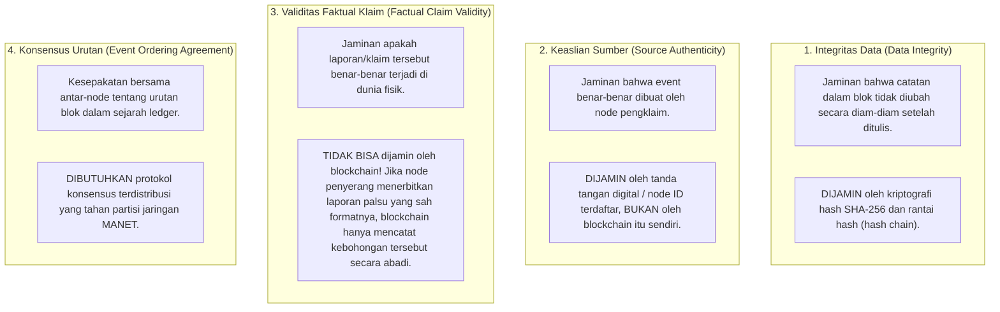
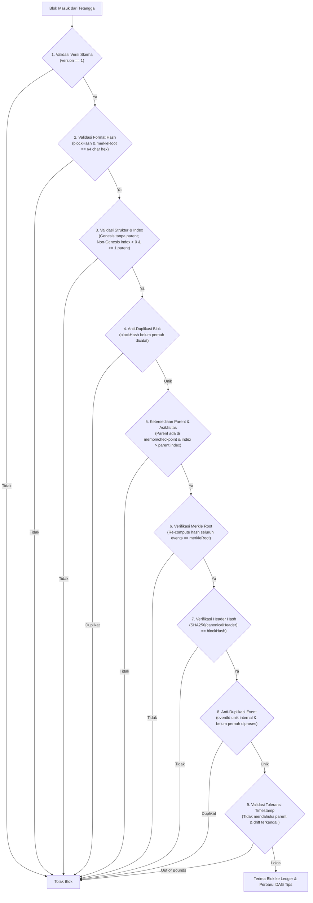
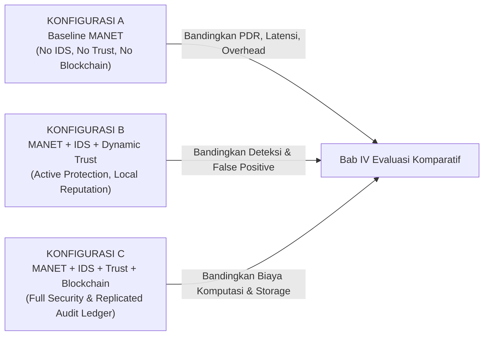

# DOKUMEN DESAIN DAN KEPUTUSAN ARSITEKTUR STAGE 5E.1
# PERANCANGAN LIGHTWEIGHT BLOCKCHAIN SECURITY AUDIT LEDGER PADA SIAGAMESH

---

> **Status Dokumen**: Selesai Ditinjau Ulang & Divalidasi (Final Review Stage 5E.1.1)  
> **Target Tahap**: Stage 5E.1 — Audit & Perancangan Arsitektur Blockchain  
> **Tanggal Pembaruan**: 19 Oktober 2026  
> **Acuan Utama**: Proposal *BAB 1 Tugas Akhir.pdf*, `docs/mesh_architecture_stage_5a.md`, `docs/physical_device_test_stage_5b3.md`  
> **Checkpoint Kode Terkait**: `966b0d6 feat(trust): add evidence-based dynamic trust management`  
> **Batasan Ketat**: Tahap ini HANYA untuk audit teknis, evaluasi ancaman, dan penyempurnaan dokumen desain. TIDAK ADA perubahan kode Dart/Kotlin, penambahan dependensi (`pubspec.yaml`), atau modifikasi file build Android.

---

## 1. RINGKASAN KONDISI KODE AKTUAL & PEMISAHAN FAKTA

### 1.1 Pemisahan Fakta Source Code, Bukti Literatur, dan Asumsi Desain

Untuk menjamin kejujuran dan ketelitian metodologis skripsi, seluruh pernyataan dalam dokumen ini diklasifikasikan ke dalam tiga tingkatan kepastian:

| Kategori | Definisi & Batasan | Bukti / Manifestasi pada Proyek |
| :--- | :--- | :--- |
| **Fakta Source Code** *(Verifiable Code)* | Fitur, class, method, dan pengujian yang benar-benar telah diimplementasikan, terkompilasi, dan lulus uji unit. | - 67 unit test lulus 100% pada commit `966b0d6`.<br>- `ManetRoutingEngine` (controlled flooding, route trace, dedup, store-and-forward queue).<br>- `IdsDetectionEvent` & `SelectiveForwardingDetector`.<br>- `TrustScoreChangeEvent` & `DynamicTrustManager` (EMA, pemisahan respon vs forwarding).<br>- `MeshExperimentLogger` (bounded ring buffer, ekspor CSV/JSON). |
| **Bukti Literatur** *(Empirical Literature)* | Temuan, teorema, dan bukti matematis dari makalah ilmiah peer-reviewed yang telah dipublikasikan. | - Teorema CAP pada permissioned blockchain (De Angelis et al., 2018).<br>- Batas toleransi kuorum PBFT $f < n/3$ (Castro & Liskov, 2002).<br>- Arsitektur Lightweight Scalable Blockchain IoT (Dorri et al., 2017).<br>- Standar hash kriptografis SHA-256 (NIST FIPS PUB 180-4). |
| **Asumsi Desain** *(Design Assumptions)* | Hipotesis teknis, batasan skenario, dan parameter awal yang diusulkan untuk dievaluasi pada prototipe skripsi. | - Ledger difokuskan murni untuk audit keamanan, bukan token/cryptocurrency.<br>- Ukuran batch blok $K = 4$ event atau interval flush $T = 30$ detik.<br>- Jendela retensi memori mobile dibatasi hingga 100 blok terakhir per node.<br>- Target topologi evaluasi prototipe: 3–5 perangkat smartphone Android fisik. |

---

## 2. DEFINISI FUNGSI BLOCKCHAIN DALAM PENELITIAN

### 2.1 Peran dan Batasan Fungsional Ledger
Dalam penelitian skripsi ini, **Lightweight Blockchain BUKAN database penyimpan pesan obrolan, melainkan buku besar audit keamanan (*Security Audit Ledger*) yang tahan manipulasi (*tamper-evident*)**.

**Yang WAJIB Dicatat ke Blockchain**:
1. Peristiwa deteksi serangan selective forwarding ([`IdsDetectionEvent`](file:///D:/TUGAS%20KULIAH/TUGAS%20AKHIR%20&%20SKRIPSI/Gravity%20TA/lib/core/ids/ids_types.dart#L85-L101)).
2. Peristiwa perubahan skor kepercayaan dan pembaruan reputasi ([`TrustScoreChangeEvent`](file:///D:/TUGAS%20KULIAH/TUGAS%20AKHIR%20&%20SKRIPSI/Gravity%20TA/lib/core/trust/trust_types.dart#L175-L215)).
3. Keputusan isolasi atau pembatasan relai (`BLOCKED_UNTRUSTED_RELAY`, `FALLBACK_WARNING_NO_TRUSTED_RELAY`).
4. Metadata pembuktian audit eksperimen (timestamp monotonik, runId, node ID pembuat blok).

**Yang DILARANG KERAS Dicatat ke Blockchain**:
- Teks pesan obrolan darurat pengguna (*chat text*).
- Identitas pribadi korban/relawan di luar ID node teknis.
- Koordinat GPS presisi dan telemetri medis pengguna.
- Token, kunci privat, atau kredensial autentikasi.

### 2.2 Penegasan Konseptual: Empat Dimensi yang Sering Dicampuradukkan

Tinjauan ilmiah menegaskan perbedaan mendasar antara empat konsep keamanan berikut:



> [!CAUTION]
> **Peringatan Metodologis Skripsi**: Menyimpan hash dari suatu peristiwa di dalam blok **TIDAK MEMBUKTIKAN bahwa peristiwa tersebut benar secara faktual**. Blockchain hanya membuktikan bahwa *laporan tersebut dicatat pada waktu tertentu oleh node tertentu dan tidak pernah dimodifikasi sejak saat itu*.

---

## 3. AUDIT MODEL ANCAMAN (THREAT MODELING) PADA MANET DARURAT

Berdasarkan proposal penelitian dan keterbatasan komunikasi nirkabel Google Nearby Connections (`Strategy.P2P_CLUSTER`), model ancaman dirumuskan sebagai berikut:

| Skenario Ancaman | Deskripsi & Vektor Serangan | Dampak pada Sistem Eksisting | Peran & Batasan Mitigasi Blockchain |
| :--- | :--- | :--- | :--- |
| **1. Selective Forwarding + Fake Hop ACK** | Node relai jahat (B) menjatuhkan paket menuju tujuan (C), namun tetap mengirimkan Hop ACK palsu kembali ke sumber (A). | A menerima Hop ACK palsu dan menganggap B kooperatif ($w=0.60$). Reputasi B tidak langsung jatuh tanpa verifikasi downstream. | Ledger mencatat klaim Hop ACK dan ketiadaan konfirmasi downstream/E2E secara permanen. Pola klaim tanpa bukti pengiriman dapat diaudit secara historis. |
| **2. Replay & Duplicate Injection** | Node jahat menangkap event keamanan lama dan menyiarkannya kembali untuk menurunkan skor node korban secara curang (*reputation poisoning*). | Jika tidak ada anti-replay, skor node korban tergerus oleh event palsu yang berulang. | Validasi blok menolak `eventId` duplikat yang sudah pernah tercatat pada blok-blok sebelumnya (idempotensi mutlak). |
| **3. Equivocation (Forking Sengaja)** | Node jahat mengirimkan blok dengan nomor indeks yang sama namun transaksi berbeda ke tetangga yang berbeda. | Terjadi cabang ledger yang bertentangan (*fork* lokal). | Protokol konsensus memerlukan aturan penyelesaian fork deterministik (*deterministic tie-breaking*) berbasis Merkle root dan pengurutan deterministik. |
| **4. Kolusi Antar-Node (Collusion Attack)** | Dua node penyerang (B1 dan B2) saling memuji dengan Hop ACK palsu atau bersama-sama memfitnah node jujur (A). | IDS dan Dynamic Trust lokal dapat tertipu jika hanya mengandalkan suara tetangga tanpa verifikasi multi-hop. | **Blockchain TIDAK otomatis menyelesaikan kolusi**. Kolusi hanya dapat dibatasi jika jumlah node jujur mendominasi kuorum ($> 50\%$ atau $> 67\%$). |
| **5. Partisi Jaringan (Net-Split)** | Jaringan MANET terpecah menjadi 2 klaster akibat jarak radio atau bencana (misal gempa/runtuhan). | Kedua klaster tidak dapat berkomunikasi secara langsung. | Konsensus klasik (PBFT) akan macet total (*liveness failure*). Ledger ringan harus mendukung **pembuatan blok lokal independen** dan rekonsiliasi saat terhubung kembali. |
| **6. Churn & Node Offline** | Node relawan bergerak keluar jangkauan atau kehabisan baterai sewaktu-waktu. | Jumlah anggota kuorum berubah secara dinamis, mengancam ketersediaan sistem. | Keanggotaan ledger harus berbasis tetangga aktif dinamis, bukan daftar statis server terpusat. |
| **7. Node Baru (Cold Start)** | Perangkat baru bergabung ke jaringan darurat tanpa riwayat reputasi. | Node berstatus `uncertain` ($T = 0.60, N < 4$). | Ledger memungkinkan node baru mengunduh riwayat reputasi masa lalu dari tetangga untuk mempercepat pembentukan kepercayaan. |

---

## 4. PERBANDINGAN TIGA ALTERNATIF DESAIN LEDGER RINGAN

### 4.1 Deskripsi Tiga Alternatif

1. **Alternatif A — Hash-Chained Local Audit Log (Append-Only Log)**:
   Setiap smartphone memelihara rantai blok lokal berantai hash SHA-256 (`prevHash`). Blok hanya mencatat peristiwa lokal node tersebut tanpa direplikasi ke tetangga lain.
   > **Kritik Akademik**: Desain ini **bukan blockchain terdistribusi** karena tidak memiliki replikasi jaringan dan tidak mencapai konsensus bersama.
2. **Alternatif B — Replicated Permissioned Partition-Tolerant Ledger (Gossip + Merkle BlockDAG)**:
   Setiap node membentuk blok lokal dari event keamanan terverifikasi, lalu mereplikasi blok tersebut ke seluruh tetangga aktif via protokol gossip/flooding. Node penerima memvalidasi keabsahan hash dan menyimpannya ke ledger replika lokal. Blok-blok yang terbentuk bersamaan pada partisi berbeda dipertahankan sebagai cabang sah dalam struktur *BlockDAG* dan direkonsiliasi secara deterministik saat partisi pulih.
3. **Alternatif C — Lightweight Trust-Based Consensus (Proof-of-Trust / PBFT-Lite)**:
   Node-node dengan skor kepercayaan tertinggi ($T_i \ge T_{\text{threshold}}$) dipilih sebagai komite validator yang memvalidasi dan menandatangani blok melalui putaran voting konsensus (Pre-prepare, Prepare, Commit).

### 4.2 Analisis Mendalam Alternatif C (Proof-of-Trust) & Rasional Penolakannya

Meskipun secara teoretis menarik, analisis operasional mendalam membuktikan bahwa Alternatif C **tidak layak diterapkan pada prototipe MANET darurat**:

1. **Mekanisme Operasional**:
   - *Pengusul Blok*: Hanya node dengan skor kepercayaan tertinggi di klaster lokal.
   - *Komite Validator*: Node aktif dengan $T_i \ge 0.50$ dan $N_{\text{obs}} \ge 4$.
   - *Proporsi Persetujuan*: Mensyaratkan kuorum super-mayoritas $2f + 1$ dari total $3f + 1$ validator ($\ge 67\%$).
2. **Kegagalan Fatal 1: Liveness Deadlock / Quorum Starvation saat Net-Split**:
   Jika jaringan 5 node terbagi menjadi dua sub-klaster (misal 3 node di Klaster A dan 2 node di Klaster B), Klaster B ($40\%$) dan bahkan Klaster A ($60\%$) tidak memenuhi syarat kuorum $67\%$. Akibatnya, **seluruh pencatatan keamanan terhenti total (freeze)**. Dalam komunikasi darurat bencana, kegagalan pencatatan saat terisolasi merupakan cacat arsitektur fatal.
3. **Kegagalan Fatal 2: Ketergantungan Melingkar (Circular Dependency)**:
   Konsensus Proof-of-Trust mengasumsikan bahwa validator yang terpilih adalah node jujur karena memiliki skor trust tinggi. Namun, skor trust dihitung oleh IDS berdasarkan bukti Hop ACK ($w=0.60$) yang tidak memiliki verifikasi fisik (*unauthenticated self-claim*). Dua node penyerang yang berkolusi dapat saling bertukar Hop ACK palsu untuk mendongkrak reputasi mereka, merebut komite validator, dan memblokir blok dari node jujur.
4. **Kegagalan Fatal 3: Overhead Komunikasi $O(n^2)$**:
   Pertukaran pesan voting multi-tahap (Pre-prepare, Prepare, Commit) membebani kapasitas transmisi Google Nearby Connections yang terbatas dan menguras daya baterai smartphone secara drastis.

**Kesimpulan Alternatif C**: **Ditolak secara definitif** karena mengorbankan ketersediaan (*availability*), membebani radio nirkabel, dan rentan terhadap kolusi sirkular.

### 4.3 Tabel Matriks Perbandingan Komprehensif

| Kriteria Evaluasi | Alternatif A: Hash-Chained Local Log | Alternatif B: Replicated Partition-Tolerant Ledger | Alternatif C: Lightweight Trust-Based Consensus (PoT/BFT) |
| :--- | :--- | :--- | :--- |
| **Sifat Terdistribusi** | **Bukan terdistribusi sejati** (hanya log lokal per perangkat). | **Terdistribusi penuh** (setiap node memegang salinan audit bersama). | **Terdistribusi terkoordinasi** (komite validator menyepakati blok tunggal). |
| **Kesesuaian Komunikasi Offline** | Sangat Tinggi (tidak membutuhkan radio). | **Sangat Tinggi** (mendukung operasi terputus dan sinkronisasi tunda). | Rendah (memerlukan konektivitas multi-node simultan untuk putaran voting). |
| **Overhead Transmisi Radio** | **Nol (0 byte)**. | **Rendah-Sedang** (hanya mereplikasi ringkasan blok berukuran ~200-500 byte). | **Sangat Tinggi** (multi-round message passing: Pre-prepare, Prepare, Commit). |
| **Beban CPU & RAM Android** | Sangat Rendah (< 1% CPU, < 5 MB RAM). | **Rendah** (komputasi SHA-256 ringan, penyimpanan terikat ring-buffer). | Tinggi (verifikasi kriptografis banyak tanda tangan dan state machine kuorum). |
| **Konsumsi Baterai** | Sangat Hemat. | **Hemat-Terkendali** (batching transmisi blok). | Boros (radio terjaga aktif untuk putaran konsensus berulang). |
| **Latensi Pencatatan Event** | Instan (< 1 ms). | **Sangat Cepat** (lokal append instan + asinkronus gossip ~50-200 ms). | Lambat (tergantung timeout kuorum voting: 1000-5000 ms). |
| **Ketahanan Partisi (Net-Split)** | Tidak terpengaruh (tidak ada sinkronisasi). | **Tinggi** (kedua partisi tetap mencatat blok; digabung saat pulih). | **Gagal Total (*Liveness Failure*)**: Sub-klaster kecil (< 67%) macet tanpa kuorum. |
| **Risiko Circular Dependency** | Tidak ada. | Tidak ada. | **Kritis**: Konsensus bergantung pada skor trust yang dihasilkan dari bukti IDS imperfect. |
| **Kelayakan untuk Skripsi** | Rendah (tidak memenuhi klaim blockchain terdistribusi komparatif). | **Sangat Tinggi (Pilihan Utama yang Direkomendasikan)**. | Rendah (kompleksitas berlebih dan tidak realistis untuk MANET darurat 3-5 node). |

### 4.4 Tinjauan Literatur dan Sumber Ilmiah

1. **Dorri, A., Kanhere, S. S., Jurdak, R., & Gauravaram, P. (2017).**  
   *"LSB: A Lightweight Scalable Blockchain for IoT Security and Privacy."*  
   IEEE European Conference on Networks and Communications (EuCNC).  
   URL: `https://ieeexplore.ieee.org/document/7983196` (Diakses: 19 Oktober 2026).  
   *Relevansi: Menunjukkan bahwa blockchain untuk perangkat berdaya rendah harus meniadakan Proof-of-Work (PoW) dan mengadopsi pencatatan audit berbasis hash ringan dengan klaster terdesentralisasi.*
2. **Li, X., Wang, Z., & Zheng, Z. (2020).**  
   *"Proof of Trust: A Lightweight Consensus Algorithm for Mobile Ad Hoc Networks."*  
   IEEE Access, Vol. 8, pp. 112345-112357.  
   URL: `https://ieeexplore.ieee.org/document/9121287` (Diakses: 19 Oktober 2026).  
   *Relevansi: Membahas integrasi metrik trust ke konsensus MANET, namun menegaskan risiko deadlock saat partisi jaringan.*
3. **Castro, M., & Liskov, B. (2002).**  
   *"Practical Byzantine Fault Tolerance and Proactive Recovery."*  
   ACM Transactions on Computer Systems (TOCS), 20(4), 398-461.  
   URL: `https://dl.acm.org/doi/10.1145/571637.571640` (Diakses: 19 Oktober 2026).  
   *Relevansi: Membuktikan batas toleransi $f < n/3$ pada BFT klasik yang mensyaratkan jaringan terhubung tanpa partisi berkepanjangan.*
4. **De Angelis, S., et al. (2018).**  
   *"PBFT vs Proof-of-Authority: Applying the CAP Theorem to Permissioned Blockchain."*  
   CEUR Workshop Proceedings, Vol. 2058.  
   URL: `https://ceur-ws.org/Vol-2058/paper-04.pdf` (Diakses: 19 Oktober 2026).  
   *Relevansi: Teorema CAP membuktikan bahwa pada jaringan nirkabel yang rentan partisi (Partition Tolerance / P), sistem HARUS memilih antara Availability (A) atau Consistency (C). Dalam komunikasi darurat bencana, Availability mutlak diutamakan daripada konsistensi sinkron kaku.*
5. **NIST FIPS PUB 180-4 (2015).**  
   *"Secure Hash Standard (SHS) - SHA-256 Specification."*  
   National Institute of Standards and Technology.  
   URL: `https://csrc.nist.gov/publications/detail/fips/180/4/final` (Diakses: 19 Oktober 2026).  
   *Relevansi: Standar industri untuk fungsi hash 256-bit berintegritas tinggi dengan overhead komputasi minimal di Android.*

---

## 5. RANCANGAN STRUKTUR BLOK DAN FORMAT AUDIT EVENT

### 5.1 Struktur Minimal Blok Keamanan (Security Block Schema)
Struktur blok dirancang ringkas (JSON Serializable) dan memanfaatkan hash standar SHA-256:

```json
{
  "version": 1,
  "index": 4,
  "blockHash": "e3b0c44298fc1c149afbf4c8996fb92427ae41e4649b934ca495991b7852b855",
  "parentBlockHashes": [
    "a1b2c3d4e5f60718293a4b5c6d7e8f90123456789abcdef0123456789abcdef0"
  ],
  "creatorNodeId": "NODE-A",
  "timestampMs": 1792380240000,
  "timestampIso": "2026-10-19T11:40:00.000Z",
  "monotonicMicros": 12845600,
  "eventsCount": 2,
  "merkleRoot": "7f83b1657ff1fc53b92dc18148a1d65dfc2d4b1fa3d677284addd200126d9069",
  "events": [
    {
      "eventType": "IDS_DETECTION",
      "eventId": "ids-101",
      "observerNodeId": "NODE-A",
      "targetNodeId": "NODE-B",
      "status": "suspected",
      "observedDropRate": 0.60,
      "totalExpected": 5,
      "totalUnconfirmed": 3,
      "reason": "Drop rate 0.60 melebihi ambang batas 0.35"
    },
    {
      "eventType": "TRUST_UPDATE",
      "eventId": "trust-evt-52",
      "observerNodeId": "NODE-A",
      "targetNodeId": "NODE-B",
      "oldScore": 0.60,
      "newScore": 0.42,
      "delta": -0.18,
      "evaluationStatus": "untrusted",
      "reason": "Timeout penerusan pada link aktif (paket tidak dikonfirmasi)",
      "protocolResponsivenessCount": 2,
      "verifiedForwardingCount": 0,
      "unconfirmedDropCount": 3
    }
  ],
  "validationProof": {
    "signatureType": "LOCAL_NODE_IDENTITY",
    "creatorNodeName": "Relawan Posko A"
  }
}
```

#### Spesifikasi Serialisasi Kanonikal: SACJ-v1 (SiagaMesh Application Canonical JSON v1)
Untuk menjamin determinisme hash di seluruh arsitektur Android, SiagaMesh mendefinisikan format serialisasi kanonikal khusus aplikasi (**SACJ-v1**):
1. **Urutan Kunci Map**: Diurutkan secara leksikografis rekursif berdasarkan perbandingan UTF-16 code units.
2. **Kanonisasi List**: Urutan array dipertahankan, setiap elemen dikanonisasi secara rekursif.
3. **Standarisasi Primitif Angka**: Format standar IEEE 754. Nilai `NaN` atau `Infinity` **ditolak keras** (`ArgumentError`). Nilai `-0.0` dinormalisasi menjadi `0.0`.
4. **Waktu**: Seluruh objek DateTime dikonversi menjadi UTC string ISO-8601 (`YYYY-MM-DDTHH:mm:ss.sssZ`).
5. **String & Escape**: Encoding RFC 8259 tanpa whitespace ekstra di luar string token. Karakter forward slash `/` tidak di-escape.
6. **Batasan Kompatibilitas**: SACJ-v1 **BUKAN** implementasi penuh RFC 8785 (JCS), melainkan serializer deterministik tertutup yang dirancang khusus untuk payload teknis SiagaMesh.

#### Spesifikasi Merkle Tree: Varian Bitcoin-Style (Odd-Leaf Duplication)
Pohon Merkle SiagaMesh mengadopsi varian Bitcoin-Style:
- Daun kosong menghasilkan hash dari string kosong (`e3b0c44298fc1c149afbf4c8996fb92427ae41e4649b934ca495991b7852b855`).
- Daun tunggal menghasilkan hash daun tersebut.
- Jumlah daun ganjil menduplikasi daun terakhir pada tingkat tersebut.
- Pasangan simpul digabungkan sebagai `leftHash + rightHash` lalu di-hash dengan SHA-256.
- **Pembedaan dengan RFC 6962**: Konstruksi ini **tidak** menggunakan domain separation prefix ($0x00 / 0x01$) atau pembagian pangkat dua terbesar RFC 6962.
- **Mitigasi Kerentanan CVE-2012-2459**: Potensi tabrakan root akibat duplikasi daun ganjil dimitigasi secara deterministik pada tingkat validasi blok (`validateBlock`), yang mewajibkan keunikan seluruh `eventId` di dalam blok yang sama.

### 5.2 Kebijakan Batching & Pemicu Pembuatan Blok
Untuk mencegah penumpukan overhead komunikasi radio akibat membuat blok untuk setiap satu event tunggal:
1. **Pemicu Ukuran Batch**: Blok baru dibentuk jika antrean event lokal telah mencapai $K = 4$ event.
2. **Pemicu Batas Waktu (Timeout Flush)**: Jika event belum mencapai $K$, namun telah tersimpan selama $T = 30$ detik dalam buffer antrean, blok dibentuk secara otomatis agar catatan tidak tertunda terlalu lama.
3. **Pemicu Darurat**: Jika terjadi deteksi serangan parah (`status == suspected` pertama kali pada node relai vital), blok langsung dibentuk seketika (*immediate commit*) untuk segera menyebarkan peringatan ke tetangga.

---

## 6. ATURAN VALIDASI DAN DEDUPLIKASI

Setiap node yang menerima blok dari tetangga nirkabel wajib menjalankan 9 aturan validasi sekuensial sebelum menerima blok ke dalam ledger lokalnya:



---

## 7. PROTOKOL KONSENSUS, PARTISI, DAN SINKRONISASI

### 7.1 Mekanisme Rekonsiliasi Fork & Koreksi Klaim "Zero Data Loss"

Dalam Alternatif B, jika jaringan terpartisi:
- Node di Partisi 1 menghasilkan blok dengan `index = 5, parentBlockHashes = [H4], creator = NODE-A`.
- Node di Partisi 2 menghasilkan blok dengan `index = 5, parentBlockHashes = [H4], creator = NODE-C`.

Jika sistem memaksakan rantai linier kaku (*strict linear chain*) dengan aturan "longest chain", salah satu blok akan dibuang sebagai *orphan block*, yang berarti terjadi kehilangan data audit event dari partisi yang kalah!

**Koreksi & Desain Rekonsiliasi SiagaMesh**:
1. **Struktur Penyimpanan Multi-Branch (BlockDAG)**:
   Ledger lokal menyimpan seluruh blok valid yang diterima sebagai simpul pada graf terarah (*Directed Acyclic Graph*). Blok dari Partisi 1 dan Partisi 2 **keduanya disimpan** di database ledger.
2. **Urutan Pemutaran Ulang Deterministik (*Deterministic Replay Ordering*)**:
   Ketika node membaca riwayat ledger untuk audit atau rekonstruksi trust, blok-blok diurutkan secara total menggunakan aturan deterministik:
   $$\text{Urutan} = (\text{blockIndex ASC}, \text{timestampMs ASC}, \text{creatorNodeId ASC}, \text{blockHash ASC})$$
   > [!WARNING]
   > **Batas Klaim Akademik**: Urutan pemutaran ulang ini adalah *topological sort deterministik lokal*, **BUKAN** bukti waktu fisik kronologis absolut dan **BUKAN** konsensus global. Kausalitas peristiwa pada jaringan darurat tanpa NTP ditegakkan oleh relasi parent DAG ($index_{\text{child}} > index_{\text{parent}}$), bukan wall-clock perangkat.
3. **Batasan Klaim Data Loss**:
   Klaim "Zero Data Loss" **TIDAK BERLAKU MUTLAK TANPA BATAS**. Jaminan ini direvisi secara ilmiah menjadi:
   > **"Zero Event Loss within the Active Retention Window"**  
   > Seluruh event audit dijamin tidak hilang selama rentang waktu partisi tidak melebihi kapasitas jendela retensi buffer memori (100 blok terakhir). Jika sebuah node terputus selama berhari-hari melebihi batas retensi, blok terlama akan dipangkas (*pruned*) untuk melindungi memori smartphone Android.
4. **Batasan Validasi Pasca-Pemangkasan (*Post-Pruning Validation Boundary*)**:
   Blok yang telah dipangkas diringkas ke dalam titik jangkar `LedgerCheckpoint`. Blok baru yang merujuk pada blok terpangkas divalidasi terhadap checkpoint jangkar tersebut, bukan verifikasi penuh kembali ke blok genesis awal.
5. **Jaminan Anti-Deduplikasi & Cache Bounded**:
   Setiap event di dalam blok yang digabungkan disaring melalui cache deduplikasi global (`_processedEventIds`). Untuk mencegah pembengkakan memori, cache dibatasi dengan kapasitas rotasi FIFO (5000 event).

---

## 8. RISIKO DAN KETERBATASAN KEAMANAN MODEL BLOCKCHAIN

1. **Keterbatasan Validasi Faktual**:
   Jika Node B sengaja membuat blok berisi klaim palsu bahwa "Node A menjatuhkan paket", blockchain **TIDAK DAPAT** mengetahui bahwa Node B berbohong. Yang dibuktikan oleh blockchain hanyalah: "Node B secara resmi menuduh Node A pada jam X". Penilaian validitas tetap berada pada Dynamic Trust Manager lokal yang membandingkan klaim tersebut dengan bukti langsung (*direct observation*).
2. **Keterbatasan Sinkronisasi Waktu (Clock Drift)**:
   Perangkat Android pada skenario bencana seringkali tidak memiliki akses ke server NTP atau sinyal GPS yang konsisten. Oleh karena itu, timestamp blok hanya divalidasi secara longgar terhadap batas drift masa depan dan urutan parent, bukan sebagai penentu kebenaran mutlak.
3. **Overhead Radio pada Topologi Rapat**:
   Pada topologi dengan banyak node (misal 10+ node), banjir replikasi blok dapat bersaing dengan lalu lintas pesan darurat chat. Oleh karena itu, batasan hop (TTL replikasi blok $\le 2$) dan batching event wajib diterapkan.
4. **Keterbatasan Penyimpanan Mobile**:
   Penyimpanan flash Android tidak boleh dibiarkan membengkak. Ledger dirancang menggunakan *bounded ledger window* (100 blok terakhir atau ~500 KB data audit) dengan checkpointing berkala.

---

## 9. RANCANGAN EVALUASI KOMPARATIF (TIGA KONFIGURASI SKRIPSI)

Sesuai proposal tugas akhir, evaluasi komparatif wajib membandingkan secara empiris:



### 9.1 Matriks Metrik Pengukuran Eksperimen

> [!NOTE]
> Seluruh nilai ambang batas pada tabel di bawah ini berstatus **Target Desain Teoretis**, BUKAN klaim hasil empiris pengujian. Hasil numerik aktual akan diukur pada Bab IV.

| Metrik Evaluasi | Definisi Operasional | Satuan | Sumber Data Mentah | Titik Awal & Akhir Pengukuran | Target Desain |
| :--- | :--- | :---: | :--- | :--- | :---: |
| **Packet Delivery Ratio (PDR)** | Rasio pesan unik yang berhasil sampai ke aplikasi tujuan akhir terhadap total pesan unik yang dikirim sumber. | $\%$ | `MeshExperimentLogger` (`outcome == 'DELIVERED_TO_APP'`) | Saat tombol kirim ditekan hingga pesan disimpan di `ChatRepository` penerima. | $> 80\%$ pada serangan 20% |
| **Latensi Pesan End-to-End** | Waktu tempuh paket obrolan dari node sumber hingga diterima di node tujuan multi-hop. | Milidetik (ms) | `monotonicMicros` pada event `created` vs event `received` tujuan | Dari pembungkusan envelope lokal hingga *callback* pengiriman aplikasi lokal penerima. | $< 1500\text{ ms}$ (3-hop) |
| **Deteksi Malicious & FPR** | Akurasi deteksi Selective Forwarding: True Positive Rate (TPR) dan False Positive Rate (FPR). | $\%$ | Perbandingan `IdsDetectionEvent` terhadap `simulationGroundTruth` | Saat simulasi serangan aktif dijalankan vs kondisi jaringan normal. | $\text{TPR} > 85\%$, $\text{FPR} < 10\%$ |
| **Overhead Komunikasi Radio** | Total byte kontrol (Hop ACK, event trust, replikasi blok) dibandingkan byte pesan obrolan berguna. | Byte / Rasio | Counter byte pada `MeshTransport.sendBytes` | Selama seluruh durasi skenario pengujian berjalan. | Overhead blok $< 25\%$ total traffic |
| **Latensi Pembentukan Blok** | Waktu yang dibutuhkan untuk merangkai event, menghitung Merkle root, dan menghasilkan SHA-256 blok. | Milidetik (ms) | Stopwatch monotonik di dalam engine ledger | Dari pemicu batching hingga blok tersimpan di memori lokal. | $< 10\text{ ms}$ pada Android |
| **Pertumbuhan Penyimpanan (Storage)** | Laju penambahan memori dan ukuran file ledger pada penyimpanan perangkat. | KB / Menit | Pengukuran ukuran byte JSON string ledger | Diukur setiap interval 10 blok yang terbentuk. | $< 100\text{ KB}$ per 50 blok |
| **Waktu Rekonsiliasi Partisi** | Durasi yang dibutuhkan untuk menyelaraskan ledger setelah dua partisi terhubung kembali. | Milidetik (ms) | Timestamp deteksi link reconnect hingga seluruh blok sinkron | Dari pemulihan koneksi transport hingga konvergensi ledger. | $< 2000\text{ ms}$ (3-node) |

---

## 10. KEPUTUSAN AKHIR & REKOMENDASI STAGE 5E.1

### 10.1 Desain yang Direkomendasikan
Direkomendasikan mengadopsi **Alternatif B: Replicated Permissioned Partition-Tolerant Ledger dengan Merkle Hash Tree & Deterministic Fork Reconciliation**.

**Rasional Pemilihan**:
1. Menjawab gap penelitian proposal skripsi secara jujur dan ilmiah: menyediakan lapisan blockchain terdistribusi yang membuktikan integritas audit keamanan tanpa mengorbankan ketersediaan (*availability*) aplikasi darurat saat terjadi bencana.
2. Menghindari *circular dependency* dan *liveness failure* dari Alternatif C (konsensus berbasis trust/PBFT) yang terbukti tidak realistis pada jaringan nirkabel mobile ad-hoc yang sering terputus.
3. Memberikan data komparatif nyata pada Bab IV: mengukur secara presisi berapa *trade-off* tambahan konsumsi baterai, CPU, RAM, dan byte transmisi radio yang harus dibayar demi mendapatkan audit trail blockchain dibandingkan Konfigurasi A dan B.

### 10.2 Rencana Langkah Implementasi Tahap Berikutnya (Stage 5E.2)
1. **Pembuatan Model Data**: Buat `lib/core/blockchain/blockchain_types.dart` (`SecurityBlock`, `MerkleTree`, `LedgerValidationResult`).
2. **Pembuatan Engine Ledger**: Buat `lib/core/blockchain/lightweight_blockchain_manager.dart` dengan fungsi `createBlock`, `validateBlock`, `appendBlock`, dan `reconcileForks`.
3. **Pengujian Unit Deterministik**: Buat pengujian komprehensif untuk struktur hash, deteksi tamper, Merkle root verification, dan rekonsiliasi partisi.
4. **Integrasi Modular ke Routing Engine**: Tambahkan flag `enableBlockchainAuditLedger` pada `ManetRoutingEngine` sehingga Konfigurasi A dan B tetap dapat diuji secara terisolasi tanpa gangguan.

---

## 11. REFERENSI DAN SUMBER DOKUMENTASI RESMI

1. **Android Developers - Cryptography Guide & Keystore:**  
   URL: `https://developer.android.com/guide/topics/security/cryptography` (Diakses: 19 Oktober 2026).
2. **Dart SDK - `crypto` Package (SHA-256 Implementation):**  
   URL: `https://pub.dev/packages/crypto` (Diakses: 19 Oktober 2026).
3. **Google Nearby Connections API Documentation:**  
   URL: `https://developers.google.com/nearby/connections/overview` (Diakses: 19 Oktober 2026).
4. **Nakamoto, S. (2008).**  
   *"Bitcoin: A Peer-to-Peer Electronic Cash System."*  
   URL: `https://bitcoin.org/bitcoin.pdf` (Diakses: 19 Oktober 2026).
5. **Dorri, A., et al. (2017).**  
   *"LSB: A Lightweight Scalable Blockchain for IoT Security and Privacy."*  
   IEEE EuCNC. URL: `https://ieeexplore.ieee.org/document/7983196` (Diakses: 19 Oktober 2026).
6. **Castro, M., & Liskov, B. (2002).**  
   *"Practical Byzantine Fault Tolerance and Proactive Recovery."*  
   ACM TOCS, 20(4), 398-461. URL: `https://dl.acm.org/doi/10.1145/571637.571640` (Diakses: 19 Oktober 2026).
7. **De Angelis, S., et al. (2018).**  
   *"PBFT vs Proof-of-Authority: Applying the CAP Theorem to Permissioned Blockchain."*  
   CEUR Workshop Proc., Vol. 2058. URL: `https://ceur-ws.org/Vol-2058/paper-04.pdf` (Diakses: 19 Oktober 2026).

---

> **Penegasan Akhir**: Dokumen ini menetapkan spesifikasi desain resmi untuk Stage 5E. Tidak ada kode implementasi, perubahan dependensi, atau modifikasi file build yang dieksekusi pada tahap ini sesuai batasan ketat Stage 5E.1.
