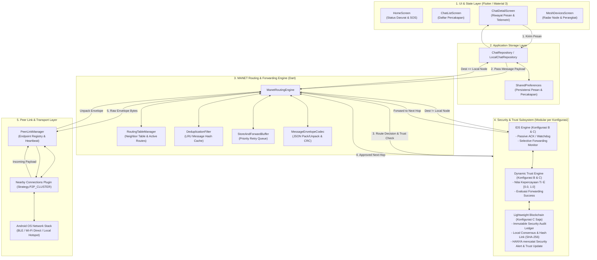
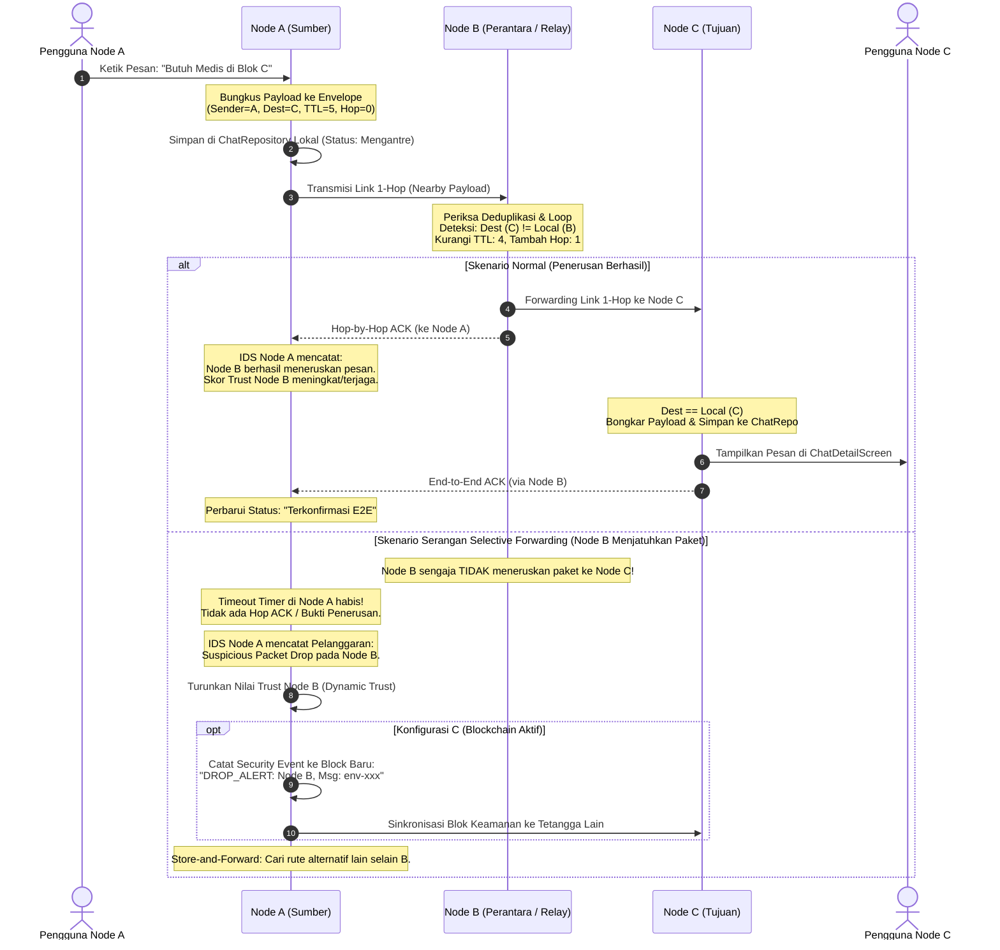
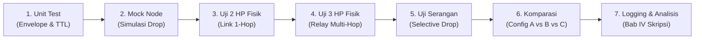

# DOKUMEN DESAIN TEKNIS ARSITEKTUR MANET SIAGAMESH (STAGE 5A)
**Rancang Bangun dan Evaluasi Komparatif Aplikasi Komunikasi Darurat Android Berbasis MANET dengan IDS, Dynamic Trust Management, dan Lightweight Blockchain**

---

## 1. RINGKASAN STATUS AKTUAL PROYEK

Audit mendalam terhadap direktori proyek `D:\TUGAS KULIAH\TUGAS AKHIR & SKRIPSI\Gravity TA` per 18 Oktober 2026 menunjukkan kondisi teknis berikut:

### 1.1 Lingkungan Pengembangan & Toolchain
- **Flutter Framework:** Versi `3.38.5` (channel stable, revision `f6ff1529fd`).
- **Dart SDK:** Versi `3.10.4` (DevTools `2.51.1`).
- **Target Platform:** Android (Namespace: `com.siagamesh.siagamesh_app`).
- **Android Gradle Plugin & Gradle:** Gradle Wrapper `8.14`, Kotlin Gradle Plugin `2.2.0`, JVM Target Java 17.
- **Konfigurasi SDK Android:**
  - `compileSdk`: Ditentukan oleh Flutter (`flutter.compileSdkVersion`, default Android 36).
  - `minSdk`: Ditentukan oleh Flutter (`flutter.minSdkVersion`, default API 21 / Android 5.0).
  - `targetSdk`: Ditentukan oleh Flutter (`flutter.targetSdkVersion`, default Android 36).
- **Status Git:** Checkpoint terakhir Stage 4B.1 berhasil di-push ke branch `main` repositori `origin` pada commit ID `5b6b791` (`feat(chat): persist local conversations and messages`). Working tree dalam kondisi bersih.

### 1.2 Kondisi Komponen Perangkat Lunak Aktual
1. **Antarmuka Pengguna (UI):**
   - Memiliki 4 layar utama berbasis Material 3:
     - Beranda (`HomeScreen`): Menampilkan status kesiapan darurat, tombol SOS, dan kartu aksi cepat.
     - Daftar Pesan (`ChatListScreen`): Filter percakapan, pencarian, dan pemicu siaran darurat lokal.
     - Detail Percakapan (`ChatDetailScreen`): Riwayat pesan, input teks manual, quick reply darurat, dan telemetri lokasi.
     - Perangkat Terdekat & Radar (`MeshDevicesScreen`): Visualisasi radar simulasi, daftar node terdekat, dan indikator koneksi mock.
2. **Model Domain & Penyimpanan Data Lokal:**
   - Model [`ChatConversation`](file:///D:/TUGAS%20KULIAH/TUGAS%20AKHIR%20&%20SKRIPSI/Gravity%20TA/lib/features/chat/models/chat_conversation.dart) telah mendukung pemetaan node unik (`peerNodeId`), serialisasi JSON, dan isolasi percakapan 1-ke-1.
   - Model [`ChatMessage`](file:///D:/TUGAS%20KULIAH/TUGAS%20AKHIR%20&%20SKRIPSI/Gravity%20TA/lib/features/chat/models/chat_message.dart) dan [`TelemetryData`](file:///D:/TUGAS%20KULIAH/TUGAS%20AKHIR%20&%20SKRIPSI/Gravity%20TA/lib/features/chat/models/chat_message.dart) mendukung serialisasi penuh dan penanda status `'Tersimpan Lokal (Simulasi)'`.
   - Lapisan [`LocalChatRepository`](file:///D:/TUGAS%20KULIAH/TUGAS%20AKHIR%20&%20SKRIPSI/Gravity%20TA/lib/features/chat/data/repositories/chat_repository.dart) mengimplementasikan in-memory caching dengan persistensi non-blocking berbasis `SharedPreferences` (skema versi 1).
3. **Pengujian & Build:**
   - Seluruh 12 pengujian otomatis (5 unit test repositori + 7 widget test UI) berstatus **100% lolos (All tests passed)**.
   - Analisis statis `flutter analyze` menghasilkan **0 issue**.
   - Kompilasi APK debug `flutter build apk --debug` berhasil menghasilkan binary valid (`build/app/outputs/flutter-apk/app-debug.apk`).

### 1.3 Fakta Teknis vs Asumsi Desain
- **Fakta:** Saat ini **belum ada komunikasi nirkabel antardevice fisik apa pun**. Seluruh data node pada radar dan daftar percakapan merupakan simulasi lokal.
- **Fakta:** `AndroidManifest.xml` saat ini **belum mendeklarasikan izin jaringan, Bluetooth, Wi-Fi, maupun lokasi runtime**.
- **Fakta:** Protokol MANET multi-hop, deteksi intrusi (IDS), pengelolaan reputasi dinamis (Dynamic Trust), serta Lightweight Blockchain **belum diimplementasikan dalam kode**.

---

## 2. RINGKASAN GAP ANALYSIS PROPOSAL TUGAS AKHIR

### 2.1 Identitas & Acuan Penelitian
- **Judul Skripsi:** *Rancang Bangun dan Evaluasi Komparatif Aplikasi Komunikasi Darurat Android Berbasis MANET dengan IDS, Dynamic Trust Management, dan Lightweight Blockchain*.
- **Peneliti:** I Kadek Agus Widiantara (NIM: 2305551050).
- **Pembimbing:** Kadek Suar Wibawa, M.T. & Dr.Eng. I Made Agus Dwi Suarjaya, S.T., M.Eng.
- **Institusi:** Program Studi Teknologi Informasi, Fakultas Teknik, Universitas Udayana (2026).

### 2.2 Latar Belakang Masalah Riil
Bencana alam (seperti bencana banjir bandang dan longsor di wilayah Sumatera pada akhir November 2025 yang melumpuhkan 2.287 dari 3.414 BTS telekomunikasi) membuktikan bahwa infrastruktur seluler dan internet terpusat sangat rentan terputus total. Dalam kondisi isolasi infrastruktur, dibutuhkan jaringan swa-organisasi (*self-organizing*) seperti Mobile Ad-hoc Network (MANET) yang beroperasi langsung antar-smartphone warga dan relawan.

### 2.3 Analisis Kesenjangan Riset (Research Gap)
Berdasarkan tinjauan pustaka terhadap 10 literatur terkini pada proposal skripsi:
1. **Conecta2 (Salamanca et al., 2024):** Mengembangkan aplikasi Android darurat dengan Wi-Fi Direct dan Bluetooth, namun pengujian tidak membuktikan routing multi-hop formal dan belum mengintegrasikan mekanisme keamanan, trust dinamis, maupun blockchain.
2. **BL-IDS (Ilakkiya & Rajaram, 2024):** Mengusulkan integrasi blockchain dan IDS untuk MANET, tetapi dievaluasi murni dalam simulasi perangkat lunak, bukan aplikasi Android fisik.
3. **Trust-Based Routing (Nivedita et al., 2025):** Menggabungkan trust dengan IDS pada tingkat jaringan simulasi, tanpa aplikasi pesan darurat Android dan tanpa pencatatan terdistribusi blockchain.
4. **DBlock-Auth (Sugumaran et al., 2025):** Menggunakan blockchain untuk autentikasi MANET dalam simulasi jaringan, berorientasi tingkat jaringan bukan aplikasi pengguna akhir.
5. **Kajian Kritis Blockchain MANET (Khalladi et al., 2025; Shinde & Goyal, 2026):** Menegaskan bahwa penggabungan blockchain dan IDS pada MANET menimbulkan penalti komputasi, konsumsi energi, dan latensi yang signifikan. Keduanya menekankan kebutuhan mendesak untuk pengujian empiris pada **real-world testbed** (perangkat fisik).
6. **Konsensus Ringan IoT (Haque et al., 2024; Villegas-Ch et al., 2025):** Mengembangkan konsensus ringan (DPoS dan simplified PoS) untuk IoT, tetapi mengasumsikan jaringan yang relatif stabil, bukan topologi MANET yang dinamis dan terfragmentasi (intermittent).
7. **Multi-Komponen Terintegrasi (Tandon et al., 2026):** Menggabungkan blockchain, trust, dan federated Q-learning dalam simulasi 500 node, sehingga kontribusi masing-masing komponen sulit diisolasi dan belum teruji pada keterbatasan memori/CPU ponsel cerdas.
8. **Sistem Terpusat (Parsafar et al., 2026):** Menggunakan NS-3 dan mengandalkan unit administrator pusat, tidak sesuai untuk situasi darurat tanpa server.

### 2.4 Kesenjangan Utama yang Diatasi Penelitian Ini
> **Inti Gap:** *Belum adanya implementasi prototipe aplikasi komunikasi darurat Android pada perangkat fisik nyata yang mengintegrasikan pengiriman pesan teks multi-hop secara desentralisasi, deteksi selective forwarding menggunakan IDS, pembaruan Dynamic Trust, serta pencatatan audit Lightweight Blockchain, yang dievaluasi secara komparatif dan terukur antar-konfigurasi.*

### 2.5 Batasan Wajib Skripsi
1. Berjalan pada perangkat Android tanpa memerlukan koneksi internet atau server pusat.
2. Komunikasi terbatas pada pesan teks dan telemetri koordinat darurat.
3. **Isi pesan pengguna (chat payload) TIDAK PERNAH disimpan di dalam blockchain**. Blockchain secara ketat hanya digunakan untuk mencatat *security events* (peringatan IDS, pembaruan skor trust, dan status blacklist node).
4. Fokus serangan dibatasi pada **Selective Forwarding Attack** (node perantara yang sengaja menjatuhkan sebagian paket pesan).
5. Pengujian dilakukan di lingkungan terkendali pada perangkat Android fisik.

---

## 3. RISET DAN PERBANDINGAN TEKNOLOGI TRANSPORT NIRKABEL ANDROID

Untuk mengaktifkan MANET pada perangkat Android tanpa infrastruktur, dievaluasi 4 teknologi komunikasi *device-to-device* (D2D).

### 3.1 Tabel Perbandingan Komprehensif

| Kriteria Evaluasi | 1. Google Nearby Connections (`Strategy.P2P_CLUSTER`) | 2. Wi-Fi Direct (`android.net.wifi.p2p`) | 3. Bluetooth Low Energy (BLE / `android.bluetooth.le`) | 4. Wi-Fi Aware / NAN (`android.net.wifi.aware`) |
| :--- | :--- | :--- | :--- | :--- |
| **Komunikasi Tanpa Internet** | Ya, 100% offline via radio lokal. | Ya, 100% offline. | Ya, 100% offline. | Ya, 100% offline. |
| **Discovery & Pembentukan Link** | Cepat & terabstraksi (BLE untuk advert/discover, negosiasi otomatis). | Memerlukan negosiasi Group Owner (GO) dan pertukaran credential (5-15 detik). | Cepat via BLE Advertising & Scanning (GATT service discovery). | Cepat via Publish/Subscribe NAN clusters. |
| **Throughput Data** | Sedang hingga Tinggi (berpindah otomatis ke Wi-Fi Hotspot/P2P jika payload besar). | Sangat Tinggi (hingga puluhan Mbps via 802.11n/ac). | Rendah (~10-50 kbps efektif; MTU standar 23-512 byte). | Tinggi (hingga puluhan Mbps via Wi-Fi data path). |
| **Dukungan Topologi Link** | **M-to-N (Cluster):** Setiap node dapat menginisiasi dan menerima banyak link secara simultan. | **Star/Tree (1-to-N):** Satu Group Owner melayani banyak Client. Client tidak bisa multi-connect ke GO lain. | **Dual Role:** Central dan Peripheral simultan (terbatas 4-7 koneksi simultan per chipset). | **Cluster Mesh:** Mendukung data path antar-peer dalam cluster NAN. |
| **Dukungan Multi-Hop Routing Bawaan** | **TIDAK ADA.** Hanya menyediakan link 1-hop antar-endpoint tetangga. | **TIDAK ADA.** Hanya menyediakan link layer IP dalam satu grup Wi-Fi P2P. | **TIDAK ADA.** Hanya menyediakan koneksi GATT point-to-point. | **TIDAK ADA.** Hanya menyediakan link layer IPv6 local data path. |
| **Ketergantungan Google Play Services (GMS)** | **YA.** Memerlukan Google Play Services terpasang di perangkat Android. | **TIDAK.** Merupakan Android Native Framework API (`android.net.wifi.p2p`). | **TIDAK.** Merupakan Android Native Framework API (`android.bluetooth.*`). | **TIDAK.** Merupakan Android Native Framework API (`android.net.wifi.aware`). |
| **Dukungan Perangkat & Fragmentasi Vendor** | Sangat Luas (didukung di hampir seluruh perangkat Android GMS, API 21+). | Tersedia luas, namun implementasi vendor (Samsung, Xiaomi, Transsion) sering inkonsisten pada negosiasi GO. | Universal (hampir 100% smartphone Android modern mendukung BLE 4.2/5.0). | **SANGAT TERBATAS.** Banyak chipset low/mid-range (MediaTek Helio, Unisoc) tidak menyediakan modul firmware NAN. |
| **Izin Android yang Dibutuhkan** | Bluetooth Scan/Connect/Advertise, Access Fine Location, Nearby Devices (Android 13+). | Access Fine Location, Nearby Wi-Fi Devices (API 33+), Change/Access Wi-Fi State. | Bluetooth Scan/Connect/Advertise, Access Fine Location (Android 11-). | Access Fine Location, Nearby Wi-Fi Devices (API 33+), Access/Change Wi-Fi State. |
| **Konsumsi Daya Baterai** | Sedang (efisien saat idle/BLE, meningkat saat transfer Wi-Fi). | Tinggi (antarmuka Wi-Fi aktif terus-menerus). | **Sangat Rendah** (sangat hemat baterai, cocok untuk darurat bencana). | Sedang-Rendah (klaster sinkronisasi hemat daya). |
| **Jangkauan Radio Relatif** | ~10-100 meter (bergantung radio aktif BLE atau Wi-Fi). | ~30-100 meter (LOS). | ~10-30 meter (bergantung kondisi fisik/dinding). | ~30-100 meter. |
| **Ketersediaan Plugin Flutter** | Sangat Baik: `nearby_connections: ^4.3.0` aktif dan stabil. | Terbatas: `flutter_p2p_connection` (kurang fleksibel untuk mesh dinamis). | Sangat Baik: `bluetooth_low_energy` / `flutter_blue_plus` + `flutter_ble_peripheral`. | Hampir tidak ada plugin Flutter publik yang stabil dan terawat. |
| **Kelayakan untuk Prototipe Skripsi** | **Sangat Tinggi (Pilihan Utama)** untuk real-world testbed multi-device. | Rendah (keterbatasan Group Owner mencegah pembentukan rantai multi-hop fleksibel). | **Tinggi (Pilihan Alternatif Non-GMS)** untuk pesan teks ringan dan koordinat. | Sangat Rendah (kendala ketiadaan hardware NAN pada perangkat uji). |
| **Risiko Utama** | Ketergantungan pada GMS; timeout disconnect jika perangkat terpisah mendadak. | Kegagalan negosiasi GO; perangkat client terputus dari grup lain. | Limit MTU (memerlukan chunking/reassembly paket) dan throughput terbatas. | Kegagalan inisialisasi pada smartphone kelas menengah (`WifiAwareManager.isAvailable() == false`). |

### 3.2 Penegasan Konseptual: P2P Bukan MANET Multi-Hop
> **PENTING:** Seluruh teknologi transport di atas (termasuk Nearby Connections dan Wi-Fi Direct) **HANYA menyediakan konektivitas 1-hop (satu lompatan fisik antar-tetangga yang berada dalam jangkauan radio)**. Tidak ada teknologi nirkabel bawaan Android yang menyediakan routing paket multi-hop secara otomatis. Oleh karena itu, **lapisan MANET Forwarding, Routing Table, Time-to-Live (TTL), Deduplikasi, dan Store-and-Forward WAJIB dirancang dan dibangun pada Lapisan Aplikasi (Application Layer)** di dalam kode SiagaMesh.

### 3.3 Sumber Dokumentasi Resmi (Diakses per 18 Oktober 2026)
1. **Google Nearby Connections API Overview:**  
   URL: `https://developers.google.com/nearby/connections/overview`  
   *Keterangan: Menjelaskan arsitektur P2P_CLUSTER, pertukaran payload bytes/file, dan strategi topologi M-to-N.*
2. **Android Developers - Wi-Fi Peer-to-Peer Guide:**  
   URL: `https://developer.android.com/guide/topics/connectivity/wifip2p`  
   *Keterangan: Dokumentasi resmi Android framework untuk class `WifiP2pManager`, pembentukan grup, dan batasan Group Owner.*
3. **Android Developers - Bluetooth Low Energy Overview:**  
   URL: `https://developer.android.com/guide/topics/connectivity/bluetooth/ble-overview`  
   *Keterangan: Dokumentasi resmi peran GATT Server (Peripheral) dan GATT Client (Central) serta batasan MTU.*
4. **Android Developers - Wi-Fi Aware (NAN) Overview:**  
   URL: `https://developer.android.com/guide/topics/connectivity/wifi-aware`  
   *Keterangan: Dokumentasi discovery session, publish/subscribe, dan persyaratan hardware `FEATURE_WIFI_AWARE`.*
5. **Pub.dev Package Repository - `nearby_connections` (v4.3.0):**  
   URL: `https://pub.dev/packages/nearby_connections`  
   *Keterangan: Plugin Flutter resmi komunitas untuk bridging Google Nearby Connections API pada Android.*

---

## 4. KEPUTUSAN ARSITEKTUR YANG DIREKOMENDASIKAN

### 4.1 Rekomendasi Utama: Google Nearby Connections (`Strategy.P2P_CLUSTER`)
- **Alasan Pemilihan:**
  1. `Strategy.P2P_CLUSTER` memungkinkan perangkat secara simultan melakukan *advertising* (agar ditemukan oleh tetangga baru) dan *discovery* (untuk menemukan tetangga di sekitarnya), membentuk topologi mesh M-to-N yang fleksibel tanpa batasan hierarki hierarkis kaku seperti Wi-Fi Direct GO.
  2. Lapisan fisik diabstraksi secara cerdas oleh sistem operasi: penemuan awal menggunakan BLE berdaya rendah, sedangkan transmisi data dapat memanfaatkan Wi-Fi Direct/Hotspot secara dinamis.
  3. Memiliki integrasi Flutter yang matang melalui plugin `nearby_connections`, sehingga siklus hidup koneksi (`onConnectionInitiated`, `onConnectionResult`, `onDisconnected`, `onPayloadReceived`) dapat dikendalikan langsung dari lapisan Dart.
- **Strategi Mitigasi Risiko:**
  - *Ketergantungan GMS:* Smartphone pengujian (misal Samsung, Xiaomi, Axioo) yang digunakan pada pengujian fisik wajib memiliki Google Play Services aktif.
  - *Disconnect Tidak Terduga:* Dilengkapi dengan *heartbeat monitoring* dan mekanisme *store-and-forward buffer* pada lapisan aplikasi.

### 4.2 Rekomendasi Alternatif: BLE Central + Peripheral Concurrency
- Jika dalam pengujian ditemukan perangkat non-GMS atau terjadi instabilitas Nearby Connections pada chipset tertentu, arsitektur cadangan menggunakan BLE murni (Central untuk scanning dan Peripheral untuk advertising) dengan packet chunking (maksimal 256 byte per chunk) menjadi opsi fallback terbaik karena sifatnya yang 100% independen dari layanan pihak ketiga.

---

## 5. DIAGRAM ARSITEKTUR SISTEM & ALUR PESAN MULTI-HOP

### 5.1 Diagram Arsitektur Berkelompok (Layered Architecture)

Arsitektur SiagaMesh dirancang modular dan memisahkan dengan tegas antara antarmuka pengguna, penyimpanan lokal, protokol perutean MANET, subsistem keamanan, dan lapisan transport nirkabel fisik.



### 5.2 Alur Transmisi Pesan Multi-Hop (Node A $\rightarrow$ Node B $\rightarrow$ Node C)

Diagram sequence berikut mengilustrasikan pengiriman pesan darurat dari **Node A (Sumber)** menuju **Node C (Tujuan)** melalui **Node B (Perantara/Relay)**, lengkap dengan pengawasan IDS terhadap selective forwarding.



---

## 6. RANCANGAN FORMAT ENVELOPE PESAN DAN IDENTITAS NODE

### 6.1 Identitas Node (Node Addressing)
Setiap perangkat pada jaringan SiagaMesh memiliki identitas yang stabil dan unik:
- **Format Node ID:** `node-<hash_8_char>` (contoh: `node-7f8a9b1c`).
- **Pembangkitan:** Dihasilkan dari SHA-256 seed perangkat lokal (misalnya UUID instalasi yang disimpan di `SharedPreferences`) untuk menjamin konsistensi lintas sesi aplikasi.
- **Human-Readable Name:** Nama perangkat yang tampil di UI (contoh: `"Posko Medis MED-0041"` atau `"Galaxy A54 (Relawan 1)"`).

### 6.2 Spesifikasi Format Envelope JSON Minimal
Seluruh data yang ditransmisikan antarnode dibungkus dalam struktur *Envelope* standar.

```json
{
  "version": 1,
  "envelopeId": "env-1718293840-a1b2c3d4",
  "type": "CHAT_MESSAGE",
  "senderId": "node-7f8a9b1c",
  "recipientId": "node-3e2d1c0b",
  "createdAt": 1718293840120,
  "ttl": 5,
  "hopCount": 0,
  "routeTrace": ["node-7f8a9b1c"],
  "signature": "",
  "payload": {
    "messageId": "msg-local-1718293840000",
    "text": "Laporan: Pasokan air bersih aman di posko 2.",
    "time": "10:30",
    "isEmergency": false,
    "telemetry": {
      "locationName": "Titik Kumpul Lapangan",
      "latitude": -8.7954,
      "longitude": 115.1762,
      "accuracy": "±6m",
      "priority": "SEDANG",
      "validationInfo": "Otentikasi Lokal"
    }
  }
}
```

### 6.3 Definisi Tipe Pesan (`type`)
1. `CHAT_MESSAGE`: Pesan obrolan reguler atau siaran antar-pengguna.
2. `HOP_ACK`: Konfirmasi penerimaan 1-hop dari tetangga langsung untuk verifikasi IDS.
3. `E2E_ACK`: Konfirmasi penerimaan akhir dari node tujuan kepada node sumber.
4. `HELLO_BEACON`: Paket broadcast periodik untuk pemeliharaan tabel tetangga (*neighbor discovery*).
5. `SECURITY_ALERT`: Notifikasi peringatan deteksi intrusi (pada Konfigurasi B & C).
6. `BLOCK_PROPOSAL` / `BLOCK_SYNC`: Transaksi dan blok Lightweight Blockchain (pada Konfigurasi C).

---

## 7. PROTOKOL ROUTING, TTL, STORE-AND-FORWARD, DAN DEDUPLIKASI

### 7.1 Strategi Routing: *Controlled Flooding with Dynamic Source Trace*
Pada lingkungan darurat bencana dengan skala 3–10 perangkat fisik:
- Protokol perutean proaktif konvensional (seperti OLSR) menghasilkan *control overhead* yang terlalu besar pada link berdaya rendah.
- Protokol reaktif murni (seperti AODV dengan fase RREQ/RREP terpisah) rentan mengalami kegagalan pembentukan rute akibat latensi discovery nirkabel pada Android.
- **Strategi Terpilih:** **Controlled Flooding dengan Rute Dinamis (Opportunistic Forwarding)**:
  - Node menyebarkan pesan ke tetangga yang terhubung langsung.
  - Setiap node menyertakan `routeTrace` dalam envelope untuk mencatat jejak jalur yang telah dilalui.
  - Jika tujuan adalah `BROADCAST`, pesan diteruskan ke seluruh tetangga terhubung (selama TTL masih berlaku).
  - Jika tujuan adalah *Unicast* (`recipientId == specific_node`), node perantara memprioritaskan meneruskan ke tetangga yang memiliki nilai Trust tertinggi dan link quality terbaik.

### 7.2 Pencegahan Loop dan Deduplikasi Pesan
1. **Deduplication Filter (LRU Cache):**
   - Setiap node memelihara cache melingkar (*Least Recently Used Cache*) berkapasitas 500 ID envelope terakhir.
   - Ketika menerima paket: jika `envelopeId` telah ada di cache, paket **langsung dibuang tanpa diproses dan tanpa diteruskan**.
2. **Loop Detection via Route Trace:**
   - Sebelum meneruskan pesan, node memeriksa field `routeTrace`. Jika ID node lokal sudah tercantum di dalam `routeTrace`, paket **langsung dijatuhkan** untuk mencegah perputaran paket dalam lingkaran (*routing loop*).

### 7.3 Batas Hop dan Kedaluwarsa (Time-To-Live / TTL)
- Nilai awal default: `ttl = 5` (cukup untuk mencakup skenario 3-5 hop pada pengujian fisik).
- Aturan Pemrosesan:
  - Setiap kali node perantara memproses pesan untuk diteruskan:
    $$\text{ttl}_{\text{baru}} = \text{ttl}_{\text{lama}} - 1$$
    $$\text{hopCount}_{\text{baru}} = \text{hopCount}_{\text{lama}} + 1$$
  - Jika $\text{ttl}_{\text{baru}} \le 0$, paket **dihapus (expired)** dan dicatat dalam log evaluasi latensi/overhead.

### 7.4 Mekanisme Store-and-Forward (Penyimpanan Antrean Darurat)
- Jaringan MANET darurat memiliki sifat terputus-putus (*intermittent connectivity*).
- Jika sebuah paket tidak dapat diteruskan karena belum ada node tetangga yang terhubung:
  - Pesan disimpan ke dalam `StoreAndForwardBuffer` lokal.
  - Buffer memiliki batas ukuran maksimal (misal 50 pesan) dan batas waktu kedaluwarsa penyimpanan (Time-To-Live Buffer: 10 menit).
  - Ketika event `onEndpointConnected` terjadi (ada perangkat baru mendekat), buffer memicu *flushing* dan mencoba meneruskan paket yang tertunda secara berurutan berdasarkan prioritas (pesan darurat/SOS didahulukan).

### 7.5 Pembedaan Link Drop Alami vs Serangan Selective Forwarding
> **PENTING UNTUK MENCEGAH FALSE POSITIVE IDS:**  
> Tidak setiap kegagalan transmisi merupakan serangan berbahaya! Dalam komunikasi nirkabel, paket dapat hilang akibat interferensi RF, *hidden node problem*, atau pergerakan fisik perangkat di luar jangkauan radio.
- **Kriteria Pembeda:**
  1. *Link Failure Alami:* Ditandai dengan putusnya koneksi transport (`onDisconnected` dari Nearby API) atau hilangnya sinyal RSSI drastis. Jika link fisik terputus, IDS **TIDAK BOLEH** menuduh node sebagai pelaku selective forwarding.
  2. *Selective Forwarding Terindikasi:* Link fisik antara Node A dan Node B terbukti aktif stabil (heartbeat responsif), namun Node B secara konsisten gagal mengirimkan `HOP_ACK` atau tidak meneruskan paket dengan persentase kegagalan $\ge P_{\text{threshold}}$ (misal > 30% dari total paket uji).

---

## 8. INTEGRASI DENGAN CHATREPOSITORY DAN MODEL YANG TERSEDIA

Arsitektur perutean dirancang menyatu secara harmonis dengan kode yang telah dibangun pada Stage 4B:

1. **Integrasi Model Domain:**
   - Model [`ChatConversation`](file:///D:/TUGAS%20KULIAH/TUGAS%20AKHIR%20&%20SKRIPSI/Gravity%20TA/lib/features/chat/models/chat_conversation.dart) yang telah memiliki `peerNodeId` langsung dipetakan sebagai endpoint tujuan unicast pada lapisan perutean.
   - Model [`ChatMessage`](file:///D:/TUGAS%20KULIAH/TUGAS%20AKHIR%20&%20SKRIPSI/Gravity%20TA/lib/features/chat/models/chat_message.dart) menjadi payload utama di dalam `MessageEnvelope`.
2. **Perubahan Status Pesan Dinamis:**
   - Status pesan yang sebelumnya berlabel statis `'Tersimpan Lokal (Simulasi)'` akan diperbarui secara dinamis oleh `ManetRoutingEngine`:
     - `'Mengantre di Buffer Mesh'` (belum ada tetangga).
     - `'Diteruskan melalui Node B (Relay)'` (berhasil dikirim ke hop pertama).
     - `'Terkonfirmasi Sampai di Tujuan (E2E ACK)'` (berhasil diterima oleh node akhir).
3. **Penyimpanan Transparan via [`LocalChatRepository`](file:///D:/TUGAS%20KULIAH/TUGAS%20AKHIR%20&%20SKRIPSI/Gravity%20TA/lib/features/chat/data/repositories/chat_repository.dart):**
   - Saat pengguna mengirim pesan di UI, pesan disimpan ke repositori lokal terlebih dahulu (menjamin persistensi jika aplikasi mati), kemudian repositori memicu `ManetRoutingEngine.transmit(envelope)`.
   - Saat `ManetRoutingEngine` menerima paket dari jaringan nirkabel dan tujuan akhir adalah node lokal, engine langsung memanggil `repository.saveMessage(convId, message)` sehingga pesan masuk ke `SharedPreferences` dan UI terpicu otomatis.

---

## 9. DESAIN TIGA KONFIGURASI EKSPERIMEN KOMPARATIF (A, B, C)

Untuk menjawab Rumusan Masalah 2 dan 3 pada proposal skripsi secara metodologis dan sahih, sistem dirancang dengan **tiga konfigurasi eksperimen yang dapat diaktifkan melalui sakelar konfigurasi (*Feature Toggle*)**:

```mermaid
graph TD
    subgraph Config_A ["Konfigurasi A — Baseline"]
        A1["Transport P2P_CLUSTER"] --> A2["MANET Multi-hop Routing"]
        A2 --> A3["ChatRepository Lokal"]
    end

    subgraph Config_B ["Konfigurasi B — IDS & Dynamic Trust"]
        B1["Transport & MANET (Identik Config A)"] --> B2["IDS Engine (Watchdog / ACK)"]
        B2 --> B3["Dynamic Trust Evaluator"]
        B3 --> B4["Trust-Based Routing Decision"]
    end

    subgraph Config_C ["Konfigurasi C — IDS, Trust, & Lightweight Blockchain"]
        C1["Transport & MANET (Identik Config A)"] --> C2["IDS Engine (Identik Config B)"]
        C2 --> C3["Dynamic Trust (Identik Config B)"]
        C3 --> C4["Lightweight Blockchain Ledger\n(Mencatat Alert Keamanan & Nilai Trust)"]
    end
```



### 9.1 Konfigurasi A — Baseline (MANET Multi-Hop Murni)
- **Karakteristik:**
  - Hanya menjalankan komunikasi pesan teks multi-hop.
  - Seluruh node diasumsikan kooperatif (tidak ada evaluasi perilaku atau skor kepercayaan).
  - Tidak ada deteksi intrusi dan tidak ada pencatatan blockchain.
- **Tujuan Pengukuran:**
  - Menghasilkan nilai dasar (*baseline*) untuk: PDR, latensi pengiriman, overhead komunikasi normal, serta penggunaan CPU dan RAM dasar pada perangkat fisik.

### 9.2 Konfigurasi B — IDS dan Dynamic Trust Management
- **Karakteristik:**
  - Mekanisme pengiriman pesan, transport, dan routing identik dengan Konfigurasi A.
  - **Mekanisme IDS:** Memantau apakah node perantara meneruskan paket yang dipercayakan kepadanya melalui pemantauan *Hop-by-Hop Acknowledgment* (atau pasif watchdog).
  - **Mekanisme Dynamic Trust:**
    - Setiap node memelihara tabel nilai kepercayaan terhadap tetangga langsungnya ($T_i \in [0.0, 1.0]$).
    - Bobot dinamis diperbarui berdasarkan riwayat transaksi sukses ($S_{\text{success}}$) dan gagal ($S_{\text{fail}}$):
      $$T_{\text{baru}} = \alpha \cdot T_{\text{lama}} + (1 - \alpha) \cdot \left( \frac{S_{\text{success}}}{S_{\text{success}} + S_{\text{fail}}} \right)$$
      *(dengan $\alpha \in [0, 1]$ sebagai faktor peluruhan bobot historis).*
    - Jika nilai trust node jatuh di bawah ambang batas ($T_{\text{threshold}} = 0.5$), node tersebut ditandai sebagai *untrusted* dan diisolasi dari jalur perutean berikutnya.
- **Tujuan Pengukuran:**
  - Mengukur efektivitas deteksi serangan selective forwarding, False Positive Rate (FPR), perbaikan PDR saat ada penyerang, serta penalti latensi/CPU akibat proses evaluasi trust.

### 9.3 Konfigurasi C — IDS, Dynamic Trust, dan Lightweight Blockchain
- **Karakteristik:**
  - Mempertahankan seluruh mekanisme komunikasi dan keamanan dari Konfigurasi B.
  - **Mekanisme Lightweight Blockchain:**
    - Buku besar terdistribusi ringan yang hanya berjalan di memori dan storage lokal perangkat Android.
    - **ATURAN WAJIB SKRIPSI: Isi pesan obrolan pengguna TIDAK PERNAH dimasukkan ke dalam blockchain**.
    - Transaksi yang dicatat dalam blok **HANYA** berupa peristiwa keamanan:
      ```json
      {
        "txId": "tx-9a8b7c",
        "timestamp": 1718293900000,
        "type": "TRUST_PENALTY_EVENT",
        "reporterNode": "node-A",
        "targetNode": "node-B",
        "penaltyReason": "SELECTIVE_FORWARDING_DETECTED",
        "packetDropRatio": 0.65,
        "newTrustScore": 0.32
      }
      ```
    - Struktur Blok:
      - `blockIndex` (integer berurutan).
      - `prevHash` (SHA-256 blok sebelumnya).
      - `timestamp` (waktu konsensus lokal).
      - `transactions` (daftar *security alerts*).
      - `blockHash` (SHA-256 dari seluruh header blok).

### 9.4 Evaluasi Realistis Blockchain pada Jaringan MANET yang Terputus-Putus
> **Peringatan Ilmiah untuk Skripsi:**  
> Blockchain tradisional (seperti Bitcoin PoW atau Ethereum PoS dengan validator quorum global) **TIDAK MUNGKIN berjalan pada jaringan MANET darurat** karena jaringan rentan mengalami partisi (*network partitioning*) di mana sekelompok node terpisah dari kelompok lain.
- **Solusi Realistis Lightweight Blockchain untuk Skripsi Ini:**
  1. *Konsensus Ringan (Proof-of-Trust / Local Multi-Signature):* Blok baru dapat divalidasi dan disetujui jika disahkan oleh minimal 2 node terpercaya terdekat ($T_i \ge 0.7$). Tidak ada *mining* atau komputasi hash intensif yang menguras baterai.
  2. *Penanganan Partisi & Ledger Fork:* Ketika dua klaster node yang sempat terpisah bertemu kembali, terjadi rekonsiliasi rantai: rantai blok dengan akumulasi skor trust validator tertinggi (*Heaviest Trust-Weighted Valid Chain*) diadopsi sebagai rantai kanonikal.
  3. *Pembatasan Ukuran Penyimpanan (Storage Pruning):* Untuk mencegah memori ponsel penuh, riwayat transaksi dipangkas menggunakan mekanisme *checkpoint* berkala (misal hanya menyimpan 50 blok terakhir).

---

## 10. DEFINISI OPERASIONAL METRIK PENELITIAN DAN METODE PENGUKURAN

Semua parameter pengujian didefinisikan secara matematis dan operasional agar data yang diperoleh pada Bab IV dapat dipertanggungjawabkan secara ilmiah:

### 10.1 Packet Delivery Ratio (PDR)
- **Definisi:** Persentase pesan teks unik yang berhasil diterima oleh node tujuan akhir dibandingkan dengan total pesan unik yang dikirimkan oleh node sumber dalam satu skenario pengujian.
- **Rumus Operasional:**
  $$PDR = \left( \frac{\sum P_{\text{received\_unique}}}{\sum P_{\text{sent\_unique}}} \right) \times 100\%$$
- **Titik Pengukuran:** Mulai saat tombol kirim ditekan di Node Sumber hingga paket selesai di-unpack di Node Tujuan.
- **Penanganan Anomali:** Pesan duplikat hanya dihitung satu kali. Pesan yang tidak sampai hingga batas waktu pengujian berakhir dihitung sebagai gagal ($0$).

### 10.2 Latensi Pengiriman Pesan (End-to-End Latency)
- **Definisi:** Durasi waktu yang dibutuhkan sebuah paket pesan unik dari saat diinisiasi di node pengirim hingga berhasil diterima sepenuhnya oleh aplikasi di node tujuan akhir.
- **Rumus Operasional:**
  $$\text{Latensi} = t_{\text{diterima}} - t_{\text{dikirim}} \quad (\text{milidetik})$$
- **Metode Sinkronisasi Waktu:** Mengingat pengujian dilakukan secara offline tanpa server NTP internet, node melakukan kalibrasi *timestamp offset* saat handshaking awal BLE/Nearby, atau mencatat waktu transit relatif hop-by-hop.

### 10.3 Kemampuan Deteksi Node Bermasalah (Detection Rate / True Positive Rate - TPR)
- **Definisi:** Kemampuan sistem IDS untuk secara tepat mengidentifikasi node yang sengaja menjatuhkan pesan (selective forwarding).
- **Rumus Operasional:**
  $$TPR = \left( \frac{TP}{TP + FN} \right) \times 100\%$$
  - $TP$ (*True Positive*): Node penyerang yang berhasil dideteksi dan diberi penalti trust oleh IDS.
  - $FN$ (*False Negative*): Node penyerang yang gagal dideteksi dan tetap dianggap normal.
- **Ground Truth:** Ditentukan secara pasti melalui kontrol konfigurasi eksperimen (node yang disuntikkan skrip penyerang drop paket).

### 10.4 False Positive Rate (FPR)
- **Definisi:** Persentase kesalahan IDS yang menuduh node normal yang beroperasi dengan baik sebagai penyerang akibat gangguan konektivitas alami.
- **Rumus Operasional:**
  $$FPR = \left( \frac{FP}{FP + TN} \right) \times 100\%$$
  - $FP$ (*False Positive*): Node normal yang salah dituduh sebagai penyerang.
  - $TN$ (*True Negative*): Node normal yang secara tepat diidentifikasi sebagai node baik.

### 10.5 Overhead Komunikasi Jaringan
- **Definisi:** Rasio total byte metadata protokol (header envelope, beacon, paket ACK, peringatan IDS, transaksi blok) terhadap total byte payload pesan obrolan murni yang ditransmisikan di udara.
- **Rumus Operasional:**
  $$\text{Overhead}_{\text{comm}} = \frac{\text{Total Byte Transmisi Keseluruhan} - \text{Total Byte Payload Obrolan}}{\text{Total Byte Payload Obrolan}}$$

### 10.6 Overhead Lightweight Blockchain
- **Definisi:** Biaya tambahan spesifik yang timbul akibat pengaktifan buku besar blockchain:
  1. *Ukuran Penyimpanan:* Pertambahan ukuran basis data lokal dalam kilobyte (KB).
  2. *Waktu Pembuatan Blok:* Durasi komputasi pembuatan dan validasi blok (ms).
  3. *Overhead Transmisi Blok:* Total byte pesan sinkronisasi blok yang ditransmisikan antarnode.

### 10.7 Penggunaan Sumber Daya Perangkat (CPU dan RAM)
- **Definisi:** Rata-rata (*mean*) dan nilai puncak (*peak*) dari persentase pemakaian CPU (%) serta konsumsi memori fisik RAM (*Resident Set Size* - RSS dalam MB) oleh proses aplikasi SiagaMesh.
- **Metode Pencatatan:** Dicatat menggunakan `android.os.Debug` dan pembacaan berkala dari script profiler Android (`dumpsys cpuinfo` dan `dumpsys meminfo`).

---

## 11. RENCANA PENGUJIAN DARI SIMULASI KE PERANGKAT FISIK

Pengujian disusun dalam 7 fase berjenjang untuk memastikan keandalan sebelum dilakukan eksperimen skala penuh:



### 11.1 Rincian Tahapan Rencana Uji
1. **Fase 1 — Unit Testing & Algoritma:** Menguji serialisasi envelope, pemotongan TTL, pencegahan loop, dan deduplikasi cache menggunakan suite pengujian Dart (`flutter test`).
2. **Fase 2 — Simulasi In-Memory Multi-Node:** Menjalankan 5 node virtual dalam satu runtime untuk memverifikasi logika deteksi selective forwarding (misal menyimulasikan node perantara menjatuhkan 30%, 50%, dan 100% paket) serta pembaruan rumus Dynamic Trust.
3. **Fase 3 — Pengujian Dua Perangkat Fisik (1-Hop Validation):** Menghubungkan 2 smartphone fisik via Google Nearby Connections (`P2P_CLUSTER`), memvalidasi discovery, pertukaran pesan teks, dan telemetri offline.
4. **Fase 4 — Pengujian Tiga Perangkat Fisik (Validasi Multi-Hop):** Menempatkan Node A, Node B, dan Node C secara fisik berjarak sehingga Node A berada di luar jangkauan Node C, memaksa pesan dari A diteruskan melalui Node B. Ini adalah **pembuktian empiris pertama komunikasi MANET multi-hop**.
5. **Fase 5 — Eksperimen Serangan Terkontrol:** Node B disetel dalam mode *malicious* (menjatuhkan paket secara sengaja dengan rasio tertentu). Memeriksa apakah IDS di Node A mendeteksi penurunan paket dan menurunkan nilai trust Node B.
6. **Fase 6 — Evaluasi Komparatif Konfigurasi A, B, dan C:**
   - Menjalankan skenario beban pengiriman (misal 50 pesan teks berurutan).
   - Menguji bergantian pada Konfigurasi A, Konfigurasi B, dan Konfigurasi C dalam kondisi tata letak fisik yang sama persis.
   - Mengulangi minimal 10–30 iterasi untuk menjamin validitas statistik.
7. **Fase 7 — Pencatatan Data & Rekapitulasi Bab IV:** Mengambil log mentah (CSV/JSON) yang mencakup timestamp mikrodetik, ID pesan, status penerimaan, latensi, alert IDS, overhead byte, serta penggunaan CPU/RAM untuk pembuatan grafik dan tabel pembahasan skripsi.

### 11.2 Format Pencatatan Data Mentah (CSV Logger)
Data eksperimen akan diekspor secara otomatis ke file CSV lokal di perangkat:
```csv
timestamp_ms,config,scenario_id,message_id,sender_id,relay_id,dest_id,hop_count,status,latency_ms,pdr_flag,is_malicious_relay,ids_detected_flag,trust_score,cpu_percent,ram_mb
1718293840100,CONFIG_B,SCEN_3HOP_01,msg-001,node-A,node-B,node-C,2,SUCCESS,342,1,0,0,0.95,4.2,88.5
1718293845200,CONFIG_B,SCEN_3HOP_01,msg-002,node-A,node-B,node-C,1,DROPPED,0,0,1,1,0.48,5.1,89.1
```

---

## 12. KEBUTUHAN PERANGKAT FISIK, IZIN ANDROID, DAN DEPENDENSI

### 12.1 Kebutuhan Perangkat Fisik (Hardware Testbed)
- **Laptop Pengembangan:** Axioo Mybook HYPE 5 G12 (Intel Core i5-1235U, RAM 16GB, SSD 512GB, Windows 11 Home) — sesuai Bab III.3.1.1 proposal.
- **Smartphone Pengujian:** Minimal **3 unit smartphone Android fisik** berkemampuan Bluetooth 5.0 dan Wi-Fi Direct:
  - *Perangkat 1 (Node Sumber / A):* e.g., Samsung Galaxy A54 5G (Android 14).
  - *Perangkat 2 (Node Perantara / Relay / B):* e.g., Xiaomi / Redmi Note (Android 13).
  - *Perangkat 3 (Node Tujuan / C):* e.g., Smartphone Android pendukung (Android 12/13).

### 12.2 Kebutuhan Izin Android (`AndroidManifest.xml`) untuk Stage 5B
Pada implementasi berikutnya (Stage 5B), izin berikut akan ditambahkan secara terukur:
```xml
<!-- Izin Bluetooth untuk Discovery dan Handshake -->
<uses-permission android:name="android.permission.BLUETOOTH" android:maxSdkVersion="30" />
<uses-permission android:name="android.permission.BLUETOOTH_ADMIN" android:maxSdkVersion="30" />
<uses-permission android:name="android.permission.BLUETOOTH_SCAN" android:usesPermissionFlags="neverForLocation" />
<uses-permission android:name="android.permission.BLUETOOTH_ADVERTISE" />
<uses-permission android:name="android.permission.BLUETOOTH_CONNECT" />

<!-- Izin Wi-Fi untuk Transfer Data Berkecepatan Tinggi -->
<uses-permission android:name="android.permission.ACCESS_WIFI_STATE" />
<uses-permission android:name="android.permission.CHANGE_WIFI_STATE" />
<uses-permission android:name="android.permission.NEARBY_WIFI_DEVICES" android:usesPermissionFlags="neverForLocation" />

<!-- Izin Lokasi (Wajib pada Android 11 ke bawah untuk scanning hardware nirkabel) -->
<uses-permission android:name="android.permission.ACCESS_FINE_LOCATION" />
<uses-permission android:name="android.permission.ACCESS_COARSE_LOCATION" />
```

### 12.3 Potensi Dependensi Pihak Ketiga (Rencana Stage 5B)
1. `nearby_connections: ^4.3.0` (komunikasi peer-to-peer fisik via Google Nearby Connections).
2. `permission_handler: ^11.4.0` (pengelolaan izin runtime Android secara aman dan interaktif).
3. `crypto: ^3.0.6` (hashing kriptografis SHA-256 bawaan Dart untuk rantai blok dan identitas node).

---

## 13. DAFTAR RISIKO, KEPUTUSAN TERTUNDA, DAN ROADMAP STAGE 5B

### 13.1 Manajemen Risiko Teknis
1. **Risiko Fragmentasi Vendor Android:**
   - *Dampak:* Fitur optimasi baterai agresif (seperti MIUI Battery Saver atau Samsung App Sleeping) memutus koneksi Nearby Connections saat aplikasi di latar belakang.
   - *Mitigasi:* Seluruh pengujian dilakukan dengan layar menyala (*foreground active*) dan mematikan penghemat baterai khusus aplikasi SiagaMesh.
2. **Risiko Fluktuasi Link Nirkabel Menipu IDS:**
   - *Dampak:* Paket hilang karena dinding tebal atau interferensi dianggap sebagai serangan selective forwarding (meningkatkan False Positive Rate).
   - *Mitigasi:* Menambahkan verifikasi status koneksi transport sebelum menjatuhkan penalti trust (hanya menilai jika link fisik terkonfirmasi sehat).
3. **Risiko Overheat & Konsumsi Baterai pada Blockchain:**
   - *Dampak:* Pengujian Konfigurasi C menguras baterai ponsel dengan cepat.
   - *Mitigasi:* Menerapkan konsensus berbasis Proof-of-Trust (PoT) tanpa mining PoW serta membatasi pencatatan hanya pada peristiwa anomali keamanan.

### 13.2 Keputusan Tertunda (*Pending Decisions*)
1. *Metode Sinkronisasi Waktu Antar-Smartphone:* Apakah menggunakan pendekatan *relative timestamp difference* saat handshake awal Nearby API ataukah mengimplementasikan protokol Cristian/NTP ad hoc lokal sederhana. Keputusan akan diambil setelah uji latensi 1-hop awal di Stage 5B.
2. *Kebijakan Pemangkasan Blok (Pruning):* Menentukan apakah ledger disimpan permanen di SQLite/SharedPreferences atau dipangkas per 100 blok untuk membatasi ukuran file.

### 13.3 Roadmap Tahap Implementasi Berikutnya (Stage 5B)
- **Tahap 5B.1:** Menambahkan izin Android pada `AndroidManifest.xml` dan mengintegrasikan plugin `nearby_connections`.
- **Tahap 5B.2:** Membangun `PeerLinkManager` untuk discovery, advertising, dan manajemen koneksi endpoint fisik.
- **Tahap 5B.3:** Membangun `ManetRoutingEngine` dengan format envelope, controlled forwarding, deduplikasi, dan TTL.
- **Tahap 5B.4:** Menghubungkan transport fisik dengan `ChatRepository` dan antarmuka UI.
- **Tahap 5B.5:** Pengujian 1-hop pada 2 smartphone fisik untuk memastikan transmisi teks offline berfungsi sempurna sebelum melangkah ke implementasi keamanan.

---

## 14. REFERENSI DAN DAFTAR PUSTAKA

1. **Google Developers.** (2026). *Nearby Connections API Overview and Strategies*. Diakses 18 Oktober 2026, dari `https://developers.google.com/nearby/connections/overview`.
2. **Android Open Source Project (AOSP).** (2026). *Wi-Fi Peer-to-Peer API Guide*. Android Developers. Diakses 18 Oktober 2026, dari `https://developer.android.com/guide/topics/connectivity/wifip2p`.
3. **Android Open Source Project (AOSP).** (2026). *Bluetooth Low Energy Overview*. Android Developers. Diakses 18 Oktober 2026, dari `https://developer.android.com/guide/topics/connectivity/bluetooth/ble-overview`.
4. **Android Open Source Project (AOSP).** (2026). *Wi-Fi Aware (NAN) Architecture*. Android Developers. Diakses 18 Oktober 2026, dari `https://developer.android.com/guide/topics/connectivity/wifi-aware`.
5. **Haque, A. K. M. B., et al.** (2024). *A Scalable Blockchain Based Framework for Efficient IoT Data Management Using Lightweight Consensus*. IEEE Access.
6. **Ilakkiya, S., & Rajaram, A.** (2024). *Blockchain-Enabled Lightweight Intrusion Detection System for Secure MANETs*. Journal of Network and Computer Applications.
7. **Kementerian Komunikasi dan Digital Republik Indonesia.** (2025). *Wamen Nezar: Kemkomdigi Fokuskan Internet Darurat di Wilayah Terisolir*. Portal Publik Komdigi.
8. **Khalladi, R., Fekir, Y., & Rebbah, M.** (2025). *Blockchain-Based Security Mechanisms for MANETs: A Review of Performance and Challenges*. Informatica (Slovenia), 49(31), 23–32.
9. **Nivedita, et al.** (2025). *An Integrated Trust-Based Secure Routing with Intrusion Detection for Mobile Ad Hoc Network Using Adaptive Snow Geese Optimization Algorithm*. Ad Hoc Networks.
10. **Parsafar, et al.** (2026). *An Intelligent Real-Time Intrusion Detection and Prevention Strategy for Emergency Response MANETs*. IEEE Transactions on Dependable and Secure Computing.
11. **Salamanca, M. D. P., Cables, E. H., & Ramírez, J. C.** (2024). *Conecta2: An Android App for Communication between Disaster Survivors through an ad hoc Network*. Ingenieria e Investigacion, 44(3), 1–9.
12. **Shinde, P. N., & Goyal, A.** (2026). *A comprehensive review of trust aware and optimization assisted machine learning and deep learning intrusion detection systems for mobile ad hoc networks*. Discover Artificial Intelligence, 6(1).
13. **Sugumaran, et al.** (2025). *Authentication Mechanism Based on Distributed Blockchain for Secure and Energy Efficient Mobile Ad-hoc Networks*. Computer Communications.
14. **Tandon, R., Gupta, P. K., & Cheng, X.** (2026). *Blockchain and federated Q-learning-based secure, fault tolerant, and energy efficient framework for ad hoc networks*. PLoS ONE, 21(3), 1–25.
15. **Villegas-Ch, W., et al.** (2025). *Lightweight Blockchain for Authentication and Authorization in Resource-Constrained IoT Networks*. IEEE Access.
