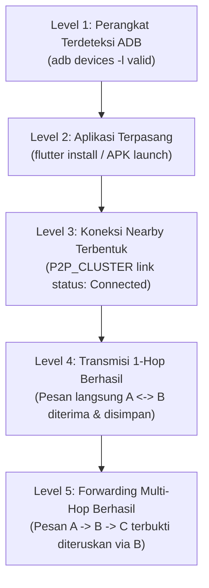

# PANDUAN DAN PROTOKOL PENGUJIAN PERANGKAT ANDROID FISIK (STAGE 5B.3)
**Validasi Transport Google Nearby Connections dan Routing Multi-Hop MANET SiagaMesh pada Real-World Testbed**

---

## 1. PENDAHULUAN & STATUS KESIAPAN PERANGKAT FISIK

### 1.1 Latar Belakang & Ruang Lingkup
Sesuai dengan analisis kesenjangan (*research gap*) pada Bab I dan metodologi Bab III proposal tugas akhir, kelulusan unit test dan simulasi in-memory (A $\rightarrow$ B $\rightarrow$ C) **bukanlah bukti empiris** bahwa gelombang radio nirkabel smartphone telah melakukan transmisi dan penerusan paket multi-hop di dunia nyata. 

Pengujian perangkat fisik nyata (*real-world physical testbed*) mutlak diperlukan untuk membuktikan:
1. Transport fisik Google Nearby Connections (`Strategy.P2P_CLUSTER`) dapat menginisiasi advertising, discovery, dan pembentukan sambungan data nirkabel secara offline tanpa router internet.
2. Lapisan MANET (`ManetRoutingEngine`) mampu melakukan *controlled forwarding*, pencatatan *route trace*, pencegahan *loop*, pengurangan TTL, deduplikasi, dan *store-and-forward* di atas sambungan radio fisik.

### 1.2 Status Ketersediaan Perangkat pada Checkpoint Ini
Berdasarkan audit toolchain dan diagnostik perangkat yang dilakukan pada lingkungan pengembangan:
- Perintah `adb devices -l` menghasilkan: `List of devices attached: (kosong / 0 perangkat terdeteksi)`.
- Perintah `flutter devices` melaporkan: Hanya target lingkungan desktop/browser (`windows`, `chrome`, `edge`), tanpa target perangkat Android fisik maupun emulator.

> [!IMPORTANT]
> **Pernyataan Integritas Ilmiah:**  
> Karena saat ini tidak ada perangkat Android fisik yang terhubung atau tersedia di laboratorium/lingkungan uji, **validasi fisik secara empiris pada Stage 5B.3 dinyatakan BELUM DILAKUKAN**. Dokumen ini menyajikan prosedur operasional standar (SOP), kondisi pengujian terkendali, instrumentasi pencatatan log, dan lembar kerja tabel kosong yang disiapkan untuk dieksekusi secara manual oleh penguji/peneliti ketika smartphone fisik telah disiapkan.

---

## 2. TAKSONOMI STATUS KESIAPAN PENGUJIAN FISIK

Untuk memastikan pelaporan hasil eksperimen pada Bab IV skripsi memiliki kejelasan dan transparansi ilmiah yang ketat, penguji wajib membedakan 5 tingkat ketercapaian berikut:



1. **Level 1 — Perangkat Terdeteksi ADB:** Smartphone terhubung via kabel data USB atau Wi-Fi ADB, mode debugging aktif, dan dikenali oleh platform-tools.
2. **Level 2 — Aplikasi Berhasil Dipasang:** Binary `app-debug.apk` berhasil terinstal dan dibuka tanpa crash, serta runtime permissions disetujui.
3. **Level 3 — Koneksi Nearby Connections Terbentuk:** Status koneksi antar-node di lapisan transport berstatus `PeerConnectionStatus.connected`.
4. **Level 4 — Pengiriman Pesan Langsung (1-Hop):** Payload envelope berhasil dikirim dari Node A dan di-unpack serta disimpan di database lokal Node B.
5. **Level 5 — Penerusan Multi-Hop Nyata (Multi-Hop Forwarding):** Node A mengirim pesan ke Node C yang berada di luar jangkauan langsung A. Pesan terbukti diterima Node C dengan `routeTrace` yang memuat Node B, dan Node B bertindak murni sebagai relay tanpa mencampur isi pesan ke percakapan lokalnya.

---

## 3. SPESIFIKASI DAN PRA-SYARAT HARDWARE TESTBED

### 3.1 Kebutuhan Perangkat Keras
- **Skenario A (Uji 1-Hop):** Minimal **2 unit smartphone Android fisik**.
- **Skenario B & C (Uji Multi-Hop & Gangguan):** Minimal **3 unit smartphone Android fisik**.
- **Laptop Host / Logger Konsol (Opsional):** Axioo Mybook HYPE 5 G12 (Windows 11) untuk memantau log Android jika terhubung ADB. Namun, pengujian radio lapangan dapat dilakukan 100% tanpa kabel ADB karena sistem telah dilengkapi `MeshExperimentLogger` in-app.

### 3.2 Persyaratan Sistem Smartphone
1. **Sistem Operasi:** Android 8.0 Oreo (API 26) hingga Android 14/15 (API 34/35).
2. **Layanan Google:** Memiliki Google Play Services (GMS) aktif dan terbaru.
3. **Radio Nirkabel:** Bluetooth 4.2 / 5.0+ dan Wi-Fi Direct/Hotspot aktif.
4. **Izin Aplikasi (Wajib disetujui di Pengaturan Android):**
   - Perangkat Terdekat (*Nearby Devices* / Bluetooth Admin & Scan).
   - Lokasi (*Access Fine Location* — wajib aktif untuk scanning BLE pada Android).
   - Wi-Fi State (*Access & Change Wi-Fi State*).
5. **Manajemen Daya Vendor:** Matikan fitur *Aggressive Battery Optimization* atau *App Sleeping* (khusus Xiaomi MIUI/HyperOS, Samsung One UI, Oppo/Vivo ColorOS) agar background radio tidak dibekukan sistem operasi saat pengujian berlangsung. Layar smartphone disarankan tetap menyala (*Stay Awake* pada Opsi Pengembang).

---

## 4. INSTRUMENTASI PENGUJIAN TERKENDALI (`MeshExperimentLogger`)

Untuk menjamin konsistensi perekaman data empiris tanpa mengorbankan privasi dan performa perangkat, sistem telah dilengkapi kelas instrumentasi [`MeshExperimentLogger`](file:///D:/TUGAS%20KULIAH/TUGAS%20AKHIR%20&%20SKRIPSI/Gravity%20TA/lib/core/routing/mesh_experiment_logger.dart).

### 4.1 Parameter yang Dicatat Secara Terstruktur
Setiap peristiwa transmisi di dalam aplikasi menghasilkan record [`MeshExperimentEvent`](file:///D:/TUGAS%20KULIAH/TUGAS%20AKHIR%20&%20SKRIPSI/Gravity%20TA/lib/core/routing/mesh_experiment_logger.dart):
- `runId`: ID unik sesi eksperimen (misal `EXP-1HOP-01` atau `EXP-MULTI-03`).
- `testType`: Kategori skenario (`1_HOP_DIRECT`, `MULTI_HOP_RELAY`, `DISTURBANCE_RECOVERY`, `BROADCAST`).
- `envelopeId` & `messageId`: ID acak unik paket untuk pelacakan end-to-end.
- `senderId` & `recipientId`: Identitas node asal dan tujuan.
- `eventType`: Siklus hidup paket (`created`, `sentToTransport`, `received`, `forwarded`, `queued`, `expired`, `rejected`).
- `localTimestampMs` & `localTimestampIso`: Waktu lokal perangkat (*Wall-Clock*).
- `monotonicMicros`: Jam monotonik lokal (`Stopwatch.elapsedMicroseconds`) untuk perhitungan durasi internal bebas *drift*.
- `hopCount` & `routeTrace`: Jumlah lompatan dan daftar node perantara yang dilalui paket.
- `connectionStatus`: Status koneksi fisik saat peristiwa (`CONNECTED`, `DISCONNECTED`, `PARTIAL`).
- `activeNeighborCount`: Jumlah tetangga 1-hop yang aktif terhubung.
- `failureReason`: Alasan penolakan (`DEDUP_CACHE_HIT`, `ROUTE_LOOP_DETECTED`, `TTL_EXPIRED`, `NO_ACTIVE_NEIGHBOR`, dll.).
- `outcome`: Hasil akhir (`DELIVERED_TO_APP`, `FORWARDED_DIRECT_NEIGHBOR`, `FORWARDED_FLOODING`, `STORED_IN_BUFFER`, `DROPPED`).

### 4.2 Prinsip Keamanan & Privasi Data
- **Hanya Data Sintetis:** Logger **TIDAK PERNAH** mencatat teks obrolan pribadi, kata sandi, token identitas, atau payload sensitif.
- Logger hanya mencatat ukuran byte (`payloadBytes`), status darurat (`isEmergency`), dan metadata routing.

### 4.3 Analisis Overhead Logging
- **Beban Memori:** Menggunakan struktur *circular bounded buffer* (maksimal 1.000 record peristiwa per sesi) dengan estimasi teoretis alokasi RAM kurang dari 150 KB (estimasi desain; belum divalidasi melalui profiling memori khusus pada hardware ponsel cerdas).
- **Beban Komputasi:** Operasi logging bersifat in-memory non-blocking dengan estimasi durasi eksekusi beberapa mikrodetik per peristiwa. Klaim ini berstatus estimasi teoretis dan belum diuji melalui benchmark komputasi khusus pada perangkat fisik.

---

## 5. SKENARIO PENGUJIAN DETAIL & LEMBAR KERJA KOSONG

### 5.1 Skenario A — Uji Langsung 1-Hop (Node A $\leftrightarrow$ Node B)

#### Tujuan
Menguji pembentukan tautan P2P_CLUSTER, pertukaran identitas handshake, transmisi payload teks sintetis, deduplikasi, dan persistensi pesan lokal antara 2 ponsel fisik.

#### Topologi Fisik
```
[ Smartphone A ] <==== Link Fisik 1-Hop ====> [ Smartphone B ]
(Node Pengirim)                               (Node Penerima)
```

#### Langkah-Langkah Operasional
1. Pasang APK pada Smartphone A dan Smartphone B.
2. Buka aplikasi SiagaMesh pada kedua perangkat. Masuk ke tab **Perangkat**.
3. Pastikan `Node ID` kedua perangkat berbeda (misal `node-a1b2` dan `node-c3d4`).
4. Pada Smartphone A: Tekan tombol **Mulai Siaran** (Advertising).
5. Pada Smartphone B: Tekan tombol **Mulai Pindai** (Discovery).
6. Saat nama Smartphone A muncul pada daftar peer di Smartphone B, tekan tombol **Hubungkan**.
7. Amati proses handshaking otomatis (auto-accept). Pastikan status berubah menjadi **Terhubung** (indikator hijau).
8. Buka percakapan dengan menekan tombol **Pesan 1-Hop**.
9. Kirim **10 pesan teks sintetis** secara bertahap (interval 5 detik antarpesan).
10. Verifikasi:
    - Pesan muncul di layar Smartphone B dan tersimpan di penyimpanan lokal B.
    - Status pesan di B menunjukkan `'Diterima (1-Hop Langsung)'`.
    - Tidak ada pesan duplikat yang diterima dua kali.
11. Catat seluruh kejadian pada tabel di bawah ini.

#### Lembar Pencatatan Hasil Uji Fisik Skenario A (Data Aktual Lapangan)
> [!NOTE]
> Tabel berikut sengaja dikosongkan untuk diisi dengan data aktual ketika pengujian fisik dengan smartphone dilaksanakan. Dilarang mengisi dengan angka simulasi fiktif.

| No. Uji | ID Pesan Sintetis | Timestamp Kirim (HP A) | Status Link Fisik | Timestamp Terima (HP B) | Status Penerimaan di B | Hop Count | Route Trace Terbaca | Keterangan / Anomali |
| :---: | :---: | :---: | :---: | :---: | :---: | :---: | :---: | :---: |
| 1 | | | | | | | | |
| 2 | | | | | | | | |
| 3 | | | | | | | | |
| 4 | | | | | | | | |
| 5 | | | | | | | | |
| 6 | | | | | | | | |
| 7 | | | | | | | | |
| 8 | | | | | | | | |
| 9 | | | | | | | | |
| 10 | | | | | | | | |

---

### 5.2 Skenario B — Uji Multi-Hop (Node A $\rightarrow$ Node B $\rightarrow$ Node C)

#### Tujuan
Membuktikan secara fisik bahwa pesan dari Node A dapat mencapai Node C melalui perantara Node B tanpa adanya koneksi radio langsung antara Node A dan Node C.

#### Topologi Fisik & Tata Letak
```
[ Smartphone A ] <--- Tautan 1 ---> [ Smartphone B ] <--- Tautan 2 ---> [ Smartphone C ]
 (Node Sumber)                       (Node Relay)                       (Node Tujuan)
       |                                                                      |
       x - - - - - - DILARANG ADA KONEKSI LANGSUNG A <-> C - - - - - - - - - x
```

#### Kondisi Pembuktian Isolasi A $\leftrightarrow$ C
> [!CAUTION]
> Jangan mengasumsikan jarak fisik (misal 50 meter) otomatis menjamin A dan C tidak saling terhubung! Penguji **WAJIB memverifikasi secara teknis**:
> 1. Pada tabel peer Smartphone A: **HANYA** ada entri untuk Smartphone B. Tidak boleh ada entri untuk Smartphone C.
> 2. Pada tabel peer Smartphone C: **HANYA** ada entri untuk Smartphone B. Tidak boleh ada entri untuk Smartphone A.
> 3. Jika Nearby Connections secara otomatis menghubungkan A langsung ke C (*shortcut*), eksperimen multi-hop dinyatakan **INVALID** dan posisi fisik perangkat harus dijauhkan atau dihalangi rintangan beton hingga tautan langsung A-C putus total.

#### Langkah-Langkah Operasional
1. Nyalakan SiagaMesh pada Smartphone A, B, dan C.
2. Bentuk koneksi 1-hop antara A dan B (Tautan 1).
3. Bentuk koneksi 1-hop antara B dan C (Tautan 2).
4. Verifikasi isolasi: Pastikan A tidak terhubung ke C, dan C tidak terhubung ke A.
5. Pada Smartphone A: Buka percakapan yang ditujukan ke `Node ID` Smartphone C.
6. Kirim **10 pesan teks sintetis** dari Smartphone A menuju C.
7. Amati perilaku pada ketiga perangkat:
   - **Pada Node A (Sumber):** Pesan terkirim ke transport menuju Node B. Status awal: `'Diteruskan (Relay Multi-Hop)'`. A tidak boleh langsung menandai pesan `'Terkonfirmasi E2E'` sebelum ACK diterima.
   - **Pada Node B (Relay):** Log mencatat `eventType = received` dengan `outcome = RELAY_TRANSIT`. Node B **TIDAK MENAMPILKAN** pesan ini di layar percakapan lokalnya sendiri. Node B kemudian meneruskan paket ke Node C dengan `eventType = forwarded`.
   - **Pada Node C (Tujuan Akhir):** Pesan diterima, status di UI: `'Diterima (1-Hop Relay)'`, dan `relayInfo` menampilkan `Relay melalui 1 hop: [Node-A → Node-B]`.
8. Verifikasi deduplikasi: Jika Node B mengirimkan paket secara ganda atau ada jalur alternatif, Node C hanya memproses dan menampilkan pesan satu kali.
9. Catat hasil pengamatan pada tabel di bawah.

#### Lembar Pencatatan Hasil Uji Fisik Skenario B (Data Aktual Lapangan)
> [!NOTE]
> Tabel berikut disiapkan kosong untuk pengisian data lapangan riil.

| No. Uji | ID Pesan | Waktu Kirim A | Terhubung B-C Valid? | Route Trace di Relay B | Waktu Terima C | Route Trace di C | Hop Count Akhir | Tampil di Chat B? (Harus TIDAK) | Status E2E di C |
| :---: | :---: | :---: | :---: | :---: | :---: | :---: | :---: | :---: | :---: |
| 1 | | | | | | | | | |
| 2 | | | | | | | | | |
| 3 | | | | | | | | | |
| 4 | | | | | | | | | |
| 5 | | | | | | | | | |
| 6 | | | | | | | | | |
| 7 | | | | | | | | | |
| 8 | | | | | | | | | |
| 9 | | | | | | | | | |
| 10 | | | | | | | | | |

---

### 5.3 Skenario C — Uji Gangguan Jaringan & Pemulihan (Store-and-Forward)

#### Tujuan
Menguji ketahanan jaringan terhadap disrupsi: pesan masuk ke antrean buffer saat tetangga/tujuan tidak ada, dan diteruskan secara otomatis saat tautan pulih.

#### Langkah-Langkah Operasional
1. Hubungkan Smartphone A dan B.
2. Putuskan sambungan radio pada Smartphone B (aktifkan Mode Pesawat pada HP B).
3. Pada Smartphone A: Kirim 3 pesan sintetis darurat menuju Node B atau C.
4. Verifikasi di Smartphone A:
   - Pesan gagal dikirim ke transport dan berstatus `'Mengantre di Buffer Mesh'`.
   - Logger mencatat `eventType = queued` dengan `failureReason = NO_ACTIVE_NEIGHBOR`.
5. Tunggu selama 60 detik.
6. Matikan Mode Pesawat pada Smartphone B dan sambungkan kembali A dengan B.
7. Verifikasi mekanisme *Flush Queue*:
   - Saat event `onConnectionResult` (CONNECTED) terpicu, `ManetRoutingEngine` secara otomatis memanggil `_flushQueueForEndpoint`.
   - Pesan yang tertunda di antrean berhasil ditransmisikan ke Smartphone B.
   - Logger mencatat `outcome = QUEUE_FLUSHED_FOR_ENDPOINT`.
8. Uji Kedaluwarsa TTL: Biarkan sebuah paket berada di antrean melampaui batas kedaluwarsa (`defaultExpiryMs = 10 menit`) atau kirim paket dengan `ttl = 0`. Verifikasi paket dibuang secara aman dengan status `expired`.

#### Lembar Pencatatan Hasil Uji Fisik Skenario C (Data Aktual Lapangan)

| No. Uji | ID Pesan | Status Koneksi Saat Kirim | Masuk Buffer? (Ya/Tidak) | Durasi Tertunda (detik) | Waktu Sambung Kembali | Terkirim Otomatis Pasca-Reconnect? | Status Akhir di Tujuan |
| :---: | :---: | :---: | :---: | :---: | :---: | :---: | :---: |
| 1 | | | | | | | |
| 2 | | | | | | | |
| 3 | | | | | | | |
| 4 | | | | | | | |
| 5 | | | | | | | |

---

## 6. METODOLOGI PENGUKURAN DAN ANALISIS METRIK

### 6.1 Packet Delivery Ratio (PDR)
- **Definisi:** Persentase pesan unik yang berhasil diterima oleh node tujuan akhir dibandingkan dengan total pesan unik yang dikirimkan oleh node sumber dalam satu jendela pengujian:
  $$PDR = \left( \frac{\sum P_{\text{received\_unique}}}{\sum P_{\text{sent\_unique}}} \right) \times 100\%$$
- **Aturan Pengukuran:**
  - Hanya pesan unik yang dihitung (berdasarkan `messageId`). Pesan duplikat akibat retransmisi/flooding tidak boleh menambah pembilang.
  - Pengujian dibatasi durasi jendela waktu (*timeout window*, misal 60 detik pascapengiriman terakhir). Pesan yang tiba setelah batas waktu dianggap *lost*.

### 6.2 Latensi: Monotonik RTT vs Latensi Satu Arah (One-Way Latency)
> [!WARNING]
> **Peringatan Metodologis Jam Nirkabel:**  
> Dilarang keras menghitung latensi satu arah dengan mengurangkan *wall-clock timestamp* Smartphone B dengan Smartphone A ($\Delta t = t_B - t_A$) jika kedua ponsel tidak tersinkronisasi dengan server waktu NTP presisi. Jam internal Android antarmerek dapat memiliki deviasi (*clock skew*) antara ratusan milidetik hingga beberapa detik, yang akan menghasilkan nilai latensi semu atau bahkan bernilai negatif!
- **Keputusan Metodologi:**
  1. *Latensi Satu Arah (One-Way):* **Ditunda** hingga mekanisme sinkronisasi clock terdistribusi (misal Cristian's Algorithm saat handshake Nearby) diimplementasikan dan divalidasi.
  2. *Round-Trip Time (RTT):* Diukur secara valid pada **satu perangkat yang sama** (Node A) menggunakan jam monotonik (`monotonicMicros`):
     $$RTT = t_{\text{monotonic\_ack\_received}} - t_{\text{monotonic\_probe\_sent}}$$
     Hasil RTT tidak terpengaruh oleh *clock drift* antardevice.
  3. RTT tidak boleh disamakan atau dibagi dua begitu saja sebagai latensi satu arah tanpa bukti simetri kanal radio.

### 6.3 Batasan Evaluasi Tahap Ini
Komponen-komponen berikut **TIDAK DIEVALUASI** pada Stage 5B.3 karena secara arsitektural dijadwalkan pada tahap lanjutan:
- *Intrusion Detection System (IDS)* dan laju deteksi selective forwarding (Tahap 5C).
- *Dynamic Trust Management* dan skor reputasi tetangga (Tahap 5C).
- *Lightweight Blockchain* dan konsensus blok (Tahap 5D).

---

## 7. KRITERIA KEBERHASILAN DAN PROSEDUR PENGAMBILAN LOG

### 7.1 Kriteria Keberhasilan Validasi Fisik
Validasi fisik pada perangkat Android nyata dinyatakan **LULUS** apabila:
1. $PDR_{\text{1-hop}} \ge 90\%$ pada kondisi *Line-of-Sight* (LOS) jarak 5–15 meter.
2. $PDR_{\text{multi-hop}} \ge 70\%$ pada topologi A $\rightarrow$ B $\rightarrow$ C dengan isolasi fisik terbukti antara A dan C.
3. Seluruh pesan transit di Node B terbukti berstatus `outcome = RELAY_TRANSIT` dan tidak muncul di percakapan lokal B.
4. Jejak rute (`routeTrace`) pada Node C secara konsisten memuat `['Node-A', 'Node-B']`.
5. Tidak ada *memory leak* atau *app crash* selama sesi transmisi berturut-turut.

### 7.2 Prosedur Ekspor Data Log dari Smartphone
Data log eksperimen dapat diekspor langsung dari aplikasi:
1. Panggil metode ekspor:
   ```dart
   final csvData = ManetRoutingHolder.logger.toCsv(runId: 'EXP-MULTI-01');
   ```
2. Atau salin log dari konsol pengembang Android via ADB:
   ```bash
   adb logcat -s "NearbyTransport" "RoutingEngine" > experiment_run.log
   ```
3. Simpan file CSV mentah ke folder `docs/results/` untuk dilampirkan sebagai data primer Bab IV skripsi.

---

## 8. KESIMPULAN STATUS STAGE 5B.3

| Komponen Evaluasi | Status Kesiapan | Catatan Evaluasi |
| :--- | :---: | :--- |
| **Kesiapan Kode Transport (Nearby Connections)** | **Siap (Ready)** | Implementasi `Strategy.P2P_CLUSTER` dan auto-accept link telah terintegrasi di `NearbyMeshTransport`. |
| **Kesiapan Protokol Routing (Multi-Hop Engine)** | **Siap (Ready)** | Controlled flooding, route trace, TTL, dedup, dan queueing telah lolos 12 unit test simulasi. |
| **Instrumentasi Eksperimen (`MeshExperimentLogger`)** | **Siap & Teruji** | Pencatatan event terstruktur, CSV export, dan isolasi data privat telah dibangun dan diuji. |
| **Ketersediaan Perangkat Fisik (Hardware Testbed)** | **Belum Tersedia** | `adb devices` = 0 unit. Tidak ada ponsel fisik yang terhubung saat eksekusi lingkungan ini. |
| **Status Validasi Fisik Lapangan** | **Ditunda (Pending)** | Prosedur uji, tata letak, dan lembar kerja kosong telah disiapkan; eksekusi fisik menunggu ketersediaan smartphone. |
